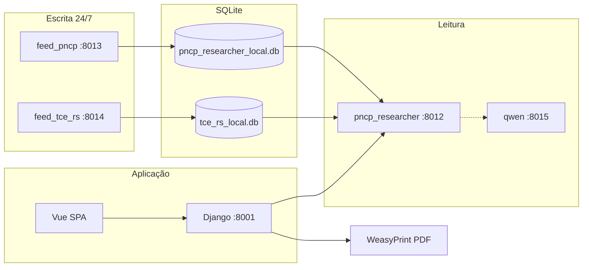

# DocMaster Core — Documentação completa do sistema

**Versão de referência:** julho/2026  
**Escopo:** funcionalidades, stacks, microsserviços, LLMs, APIs e funcionamento ponta a ponta até o estado atual do repositório `docmaster-core`.  
**Público:** desenvolvimento, operação, produto e assistentes de IA.

> Documento **autossuficiente**. Para detalhes operacionais finos, o índice em [`docs/README.md`](./README.md) aponta para módulos específicos. A visão transversal anterior (jun/2026) está em [`SISTEMA-DOCMASTER-VISAO-COMPLETA.md`](./SISTEMA-DOCMASTER-VISAO-COMPLETA.md).

---

## Índice

1. [O que é o DocMaster](#1-o-que-é-o-docmaster)
2. [Princípios de produto e arquitetura](#2-princípios-de-produto-e-arquitetura)
3. [Mapa do repositório](#3-mapa-do-repositório)
4. [Stacks e tecnologias](#4-stacks-e-tecnologias)
5. [Microsserviços e portas](#5-microsserviços-e-portas)
6. [Redes Docker e compose](#6-redes-docker-e-compose)
7. [Backend Django — negócio e API](#7-backend-django--negócio-e-api)
8. [Frontend Vue — experiência do usuário](#8-frontend-vue--experiência-do-usuário)
9. [Camada LLM — Ollama, llm_api, Qwen, llm_agent](#9-camada-llm--ollama-llm_api-qwen-llm_agent)
10. [RAG Service — geração e conformidade](#10-rag-service--geração-e-conformidade)
11. [Geração de documentos (Lei 14.133)](#11-geração-de-documentos-lei-14133)
12. [Pesquisador de preços — visão geral](#12-pesquisador-de-preços--visão-geral)
13. [Feeds independentes PNCP e TCE-RS](#13-feeds-independentes-pncp-e-tce-rs)
14. [Researcher — busca federada e IA](#14-researcher--busca-federada-e-ia)
15. [Cotações, inciso I/II/IV e relatório PDF](#15-cotações-inciso-iiiiv-e-relatório-pdf)
16. [Regras TCE-RS / LicitaCon (estado atual)](#16-regras-tce-rs--licitacon-estado-atual)
17. [Correção textual e serviços auxiliares](#17-correção-textual-e-serviços-auxiliares)
18. [Autenticação, multi-tenant e CORS](#18-autenticação-multi-tenant-e-cors)
19. [Observabilidade](#19-observabilidade)
20. [Deploy e operação](#20-deploy-e-operação)
21. [Variáveis de ambiente principais](#21-variáveis-de-ambiente-principais)
22. [Fluxos ponta a ponta (resumo narrativo)](#22-fluxos-ponta-a-ponta-resumo-narrativo)
23. [Limitações e responsabilidades](#23-limitações-e-responsabilidades)
24. [Mapa da documentação complementar](#24-mapa-da-documentação-complementar)

---

## 1. O que é o DocMaster

O **DocMaster IA** (repositório **docmaster-core**) é uma plataforma corporativa para apoiar a **administração pública brasileira** na elaboração e consolidação de artefatos ligados à **Lei nº 14.133/2021** (nova lei de licitações e contratos), com dois eixos principais:

| Eixo | Capacidade |
|------|------------|
| **Geração documental** | TR (Termo de Referência), DFD (Documento de Formalização de Demanda), Ofício, ETP e variantes por pacote de templates DOCX |
| **Pesquisa de preços** | Cotações a partir de bases públicas (PNCP e TCE-RS/LicitaCon), busca inteligente/manual, cotação direta, relatório PDF institucional |

Além disso, oferece:

- **Biblioteca de modelos** institucionais (papel timbrado / merge DOCX por prefeitura)
- **Análise de conformidade** de documentos frente à Lei 14.133 (RAG + LLM)
- **Correção gramatical** via LanguageTool
- **Observabilidade** (Prometheus + Grafana + métricas de negócio)

**Posicionamento:** ferramenta **assistiva**. Não substitui o agente público nem garante validade jurídica automática. O servidor responsável valida, seleciona e assina o uso dos preços e dos textos gerados.

Domínios públicos típicos de produção:

- SPA: `https://docmasteria.com.br`
- API: `https://api.docmasteria.com.br`

---

## 2. Princípios de produto e arquitetura

1. **Separação de responsabilidades**
   - Django = auth, multi-tenant, persistência, proxies, regras de negócio
   - FastAPI LLM/RAG = orquestração de IA e renderização documental pesada
   - Feeds PNCP/TCE = ingestão 24/7 isolada do researcher de leitura
2. **Abstração do modelo** — o backend de negócio não fala direto com Ollama/Qwen; passa por `llm_api` / `qwen_llm_service` / `rag_service`.
3. **Rastreabilidade** — logs de auditoria LLM (`llm_audit`, `qwen_llm_audit`), métricas Prometheus (`django_*`, `docmaster_*`).
4. **Timeouts conscientes** — gerações TR/DFD e fill-slots são longas; Cloudflare (~100s no plano gratuito) e nginx precisam de `proxy_read_timeout` elevados; env `RAG_HTTP_TIMEOUT` / `RAG_HTTP_TIMEOUT_TR_DFD_MAX`.
5. **Dados sensíveis** — documentos e cotações tratados como informação institucional; isolamento por `Prefeitura`.

Arquitetura lógica:

```text
Browser (Vue 3)
    │
    ▼
Django backend  ──proxy──►  rag_service  ──►  llm_agent / llm_api / qwen / Chroma / text_corrector
    │
    └──proxy──►  pncp_researcher_service  ──►  SQLite PNCP + SQLite TCE-RS (+ Qwen para rerank)
                      ▲
                      │ (somente leitura)
         price_index_feed_pncp / price_index_feed_tce_rs  (escrita 24/7)
```

---

## 3. Mapa do repositório

| Caminho | Função |
|---------|--------|
| `backend/` | Django 5.2 — API, modelos, PDF de relatório, proxies |
| `frontend-vue/` | SPA Vue 3 + Vite + TypeScript parcial |
| `llm_api/` | Orquestração LLM → Ollama |
| `llm_agent/` | Agente de estrutura/cláusulas de documento |
| `rag_service/` | RAG, geração TR/DFD/ETP/DOCX, análise |
| `qwen_llm_service/` | Gateway OpenAI-compatible → Alibaba Qwen (DashScope/MaaS) |
| `pncp_researcher_service/` | Feeds + researcher de preços (mesma imagem, modos distintos) |
| `text_corrector_service/` | Wrapper FastAPI do LanguageTool |
| `template_packages/lei_14133/` | Pacotes DOCX (dispensa 75 I/II, inexigibilidade 74 I, etc.) |
| `treinamento/` | Corpus para ingestão RAG |
| `docs/` | Documentação técnica |
| `config/` | Prometheus + Grafana provisioning |
| `deploy/` | Exemplos nginx/systemd |
| `scripts/` | Boot, PNCP, Grafana dashboard |
| `Dockerfile` (raiz) | Imagem do backend Django |
| `docker-compose.yml` | Stack principal |
| `docker-compose.pncp.yml` | Stack de feeds + researcher |

---

## 4. Stacks e tecnologias

### 4.1 Linguagens e frameworks

| Camada | Stack |
|--------|-------|
| Frontend | Vue 3, Vue Router, Vite, CSS próprio (sem design system externo dominante) |
| Backend | Python 3.11/3.12, Django 5.2, Gunicorn + gevent, django-prometheus |
| Microserviços IA | FastAPI + Uvicorn |
| PDF relatório | WeasyPrint (HTML/CSS → PDF no Django) |
| DOCX | python-docx / pipelines no `rag_service` |
| Vetores | ChromaDB |
| Índice de preços | SQLite + FTS5 (PNCP) e `platform_index` (TCE-RS) |
| Inferência local | Ollama |
| Inferência cloud | Qwen via API compatível OpenAI |
| Gramática | LanguageTool |
| Observabilidade | Prometheus, Grafana, node-exporter |
| Exposição | Cloudflare Tunnel (`cloudflared`) |

### 4.2 Persistência

| Dado | Onde |
|------|------|
| Usuários, prefeituras, documentos, cotações | SQLite Django em volume `backend_data` (`/app/backend/data`) |
| Mídia / templates upload | volume `backend_media` |
| Índice PNCP | `/data/pncp/pncp_researcher_local.db` (volume PNCP) |
| Índice TCE-RS | `/data/platforms/tce_rs_local.db` |
| Cross-refs multiplataforma | `/data/crosslink/price_cross_refs.db` |
| Raw LicitaCon | `pncp_researcher_service/data/tce_rs/raw/{ano}/` |
| Embeddings | volume ChromaDB |
| Modelos Ollama | volume `ollama_data` |

---

## 5. Microsserviços e portas

### 5.1 Stack principal (`docker-compose.yml`)

| Serviço | Porta host (típica) | Função |
|---------|---------------------|--------|
| `ollama` | 11434 | Inferência local |
| `llm_api` | 8002 | Orquestração → Ollama (`/api/llm/*`) |
| `qwen_llm_service` | 8015 | Gateway Qwen (profile `qwen`) |
| `llm_agent` | 8003 | Planejamento de estrutura/cláusulas (`/api/agent/*`) |
| `chromadb` | 8000 | Vetores |
| `languagetool` | 8010 (interna) | Motor gramatical |
| `text_corrector_service` | 8011 | `POST /correct` |
| `rag_service` | 8004 | RAG + geração documental (`/api/rag/*`) |
| `backend` | **8001→8000** | Django (host 8001 porque 8000 é Chroma) |
| `frontend-vue` | 80 (nginx) | SPA estática |
| `cloudflared-tunnel` | — | Túnel público |
| `prometheus` | 127.0.0.1:9090 | Scrape |
| `grafana` | 127.0.0.1:3000 | Dashboards |
| `node_exporter` | 127.0.0.1:9100 | Métricas de host |

### 5.2 Stack PNCP (`docker-compose.pncp.yml`, projeto Compose `docmaster-pncp`)

| Serviço | Porta host (típica) | Modo | Função |
|---------|---------------------|------|--------|
| `price_index_feed_pncp` | 127.0.0.1:8013 | `SERVICE_MODE=feed`, `FEED_PLATFORM=pncp` | Ingestão PNCP 24/7 |
| `price_index_feed_tce_rs` | 127.0.0.1:8014 | `FEED_PLATFORM=tce_rs` | Ingestão LicitaCon/TCE-RS |
| `price_index_feed_compras_gov` | 127.0.0.1:8016 | `FEED_PLATFORM=compras_gov` | CSV Dados Abertos Compras.gov (scaffold; parse pendente) |
| `pncp_researcher_service` | 127.0.0.1:8012 | `SERVICE_MODE=researcher` | Busca federada (somente leitura) |

> Em ambientes Docker Desktop / WSL onde bind de porta no host falha, usa-se override **noports** (serviço só na rede Docker; health via `docker exec`).

---

## 6. Redes Docker e compose

- Rede interna padrão do Compose + rede externa **`docmaster_net`** (compartilhada entre stack principal e PNCP, e com `qwen_llm_service`).
- Layout operacional frequente: `docker-compose.yml` em `~/` (pai do repo) com `build.context: docmaster-core`.
- **Importante:** o backend Django **não monta o código-fonte** — só volumes de `data` e `media`. Atualizar o código exige **`docker compose build backend`** + recreate, não só `force-recreate`.
- O frontend SPA também é **imagem buildada** (Vite → nginx). Mudanças Vue exigem **`docker compose build frontend-vue`**.

---

## 7. Backend Django — negócio e API

### 7.1 Estrutura

- Settings: `backend/mdlicitatech/settings.py`
- URLs: `backend/mdlicitatech/urls.py` + `backend/app/urls.py`
- App principal: `backend.app`
- Modelos relevantes:
  - `Prefeitura` / secretarias — tenant
  - `User` — `AUTH_USER_MODEL`, FK para prefeitura
  - Documentos: templates, schemas, `DocumentInstance`, slots
  - PNCP: `PncpCotacao`, `PncpCotacaoItem`, `PncpCotacaoItemCotacao`, anexos, fornecedor cadastro

### 7.2 Multi-tenant

Isolamento por **Prefeitura** (FK + middleware + slug em parte das rotas). Não é `django-tenants` com schemas separados; é multi-tenant “soft” com regras de queryset/permissão.

### 7.3 Prefixos de API (alto valor)

| Prefixo | Função |
|---------|--------|
| `/api/auth/login/`, `/logout/`, `/api/me/` | Sessão + perfil |
| `/api/documentos/fill-tr-slots` | Preenche objeto/justificativa (IA) |
| `/api/documentos/gerar-tr-e-dfd` | Gera TR + DFD (+ zip) |
| `/api/documentos/gerar-tr-modelo` | TR a partir de modelo |
| `/api/documentos/gerar-via-llm` | ETP / documento genérico via LLM |
| `/api/documentos_modelos/*` | Biblioteca / merge |
| `/api/analise-documentos/` | Conformidade |
| `/api/slots/*` | Catálogo e estado de formulários |
| `/api/llm/<path>` | Proxy → `llm_api` (ou Qwen cláusulas) |
| `/api/pncp-research/<path>` | Proxy → researcher `:8012` |
| `/api/pncp/cotacoes/research/sessions*` | Persistência de cotações/itens/fontes |
| `…/relatorio/pdf*` | Relatório PDF (sync + jobs async) |
| `/metrics` | Prometheus |

### 7.4 Serviços de relatório de preços

| Arquivo | Papel |
|---------|-------|
| `backend/app/pncp_cotacao_api.py` | CRUD cotação / itens / anexos |
| `backend/app/pncp_relatorio_api.py` | Endpoints PDF |
| `backend/app/services/pncp_relatorio_itens.py` | Agrupamento, fonte, modalidade, localidade, fornecedor |
| `backend/app/services/pncp_relatorio_pdf.py` | HTML/CSS + WeasyPrint |

---

## 8. Frontend Vue — experiência do usuário

### 8.1 Rotas principais

**Geração / documentos**

- `/geracao/etp-livre` — ETP livre
- `/geracao/dispensa-art-75-i|ii/…` e `/geracao/dispensa-rapida/…` — Dispensa Art. 75
- `/geracao/inexigibilidade-art-74-i/…` — Inexigibilidade
- `/biblioteca` — modelos
- `/analisador` — conformidade
- `/area-do-usuario`

**Pesquisador de preços** (`/pesquisador-pncp/...`)

| Rota | View | Função |
|------|------|--------|
| `/pesquisador-pncp` | `PncpResearcher.vue` | Lista/cria cotações |
| `…/cotacoes/:id` | `CotacaoDetalhe.vue` | Itens, fórmula, importação, PDF |
| `…/itens/:itemId` | `CotacaoItemDetalhe.vue` | Fontes por inciso, cards PNCP/TCE |
| `…/busca-inteligente` | `BuscaInteligenteCotacoes.vue` | Busca IA + lote |
| `…/busca-manual` | `BuscaManualCotacoes.vue` | Busca federada com filtros |
| `…/cotacao-direta` | `CotacaoDiretaRegistro.vue` | Inciso IV |
| `…/relatorio-pesquisa-precos` | `RelatorioPesquisaPrecos.vue` | Preview do relatório |

Cliente HTTP: `frontend-vue/src/services/pncpResearch.js`  
Base API: `VITE_API_URL` (produção tipicamente `https://api.docmasteria.com.br`).

### 8.2 Utilitários relevantes (preços)

| Util | Função |
|------|--------|
| `utils/pncpPricing.js` | Homologado vs estimado, faixa regional, CNPJ |
| `utils/pncpPortal.js` | Links PNCP / LicitaCon, plataforma |
| `utils/tceModalidade.js` | Códigos PCE/PCP/… → rótulos |
| `utils/tceLocalidade.js` | Ignora IBGE 7 dígitos; infere cidade do órgão |
| `utils/pncpSaveCotacoes.js` | Persistência em sessão de pesquisa |

---

## 9. Camada LLM — Ollama, llm_api, Qwen, llm_agent

### 9.1 Papéis

| Serviço | Modelo padrão | Quando usa |
|---------|---------------|------------|
| **Ollama** via `llm_api` | `qwen2.5:7b` (`OLLAMA_MODEL`) | Planejamento, seções, análise, gerações “locais” |
| **qwen_llm_service** | `qwen3.7-plus` (`QWEN_MODEL`) | ETP cloud, cláusulas (objeto/justificativa), rerank/resumo PNCP |
| **llm_agent** | chama `llm_api` | Estrutura hierárquica de cláusulas / documento |

Contrato comum de geração: `POST /api/llm/generate` (tanto `llm_api` quanto `qwen_llm_service`).

### 9.2 Encaminhamento típico

```text
Dispensa rápida
  fill-tr-slots  → rag_service → Qwen (cláusulas)
  gerar-tr-e-dfd → rag_service → (agent opcional) + llm_api/Ollama + templates DOCX

ETP livre
  gerar-via-llm → rag_service → preferencialmente Qwen (LLM_ETP_GENERATION_BASE_URL)

Busca inteligente PNCP
  researcher → PNCP_IA_BASE_URL (Qwen) para rerank / qualidade
```

### 9.3 Auditoria

- `llm_api` grava JSONL em volume `./llm_audit`
- `qwen_llm_service` grava em `./qwen_llm_audit`
- Orquestração inclui timeout, retry e mapeamento de erros tipados

Documentação: [`integracao/QWEN-INTEGRACAO-DOCMASTER.md`](./integracao/QWEN-INTEGRACAO-DOCMASTER.md), [`servicos/DOC_LLM_API.md`](./servicos/DOC_LLM_API.md), [`servicos/DOC_LLM_AGENT.md`](./servicos/DOC_LLM_AGENT.md).

---

## 10. RAG Service — geração e conformidade

**Entrada:** `rag_service/app/main.py`  
**Prefixo:** `/api/rag/*`

Capacidades principais:

| Endpoint (conceitual) | Uso |
|-----------------------|-----|
| `generate-document` | ETP / documento via LLM + contexto |
| `generate-tr-and-dfd` | Pacote TR + DFD (+ Ofício conforme fluxo) |
| `fill-tr-slots` | Preenche slots de objeto/justificativa |
| `generate-tr-from-model` | TR a partir de modelo |
| `analyze-document` / `check-compliance` | Conformidade Lei 14.133 |
| ingestão | Corpus `treinamento/` → Chroma |

Dependências internas:

- `LLM_ORCHESTRATION_BASE_URL` → `llm_api`
- `LLM_ETP_GENERATION_BASE_URL` → `qwen_llm_service` (quando ativo)
- `LLM_CLAUSULAS_GENERATION_BASE_URL` → Qwen
- `LLM_AGENT_BASE_URL` → `llm_agent`
- ChromaDB + `text_corrector_service`

Módulos-chave: `document_generator.py`, `tr_template.py`, `dfd_template.py`, `tr_slots_llm.py`, `docx_generator.py`, `llm_orchestration.py`.

---

## 11. Geração de documentos (Lei 14.133)

### 11.1 Pacotes de template

Sob `template_packages/lei_14133/`:

- Dispensa Art. 75, I e II (compras e variantes)
- Inexigibilidade Art. 74, I
- Pacotes genéricos TR/DFD
- Manutenção de veículos e outros objetos específicos

Slots e placeholders: [`geracao-documentos/01-slots-tr-dfd-oficio.md`](./geracao-documentos/01-slots-tr-dfd-oficio.md).

### 11.2 Fluxo Dispensa (simplificado)

1. Usuário preenche formulário (itens, valores, setor, etc.).
2. `POST /api/documentos/fill-tr-slots` — IA redige objeto e justificativa.
3. `POST /api/documentos/gerar-tr-e-dfd` — RAG monta DOCX (TR, DFD, eventualmente Ofício).
4. Download / gravação em “Meus Documentos”.

Cuidados operacionais: timeouts de proxy, retries no frontend (`fetchFillTrSlots.js`, `fetchGerarTrEDfd.js`), tipografia DOCX (justificação seletiva, assinatura).

### 11.3 Biblioteca e análise

- Biblioteca: merge de DOCX institucional com dados do formulário.
- Analisador: upload → RAG + LLM compara com base legal embutida no Chroma.

---

## 12. Pesquisador de preços — visão geral

Objetivo: apoiar a **pesquisa de preços** exigida pela Lei 14.133 e pela **IN SEGES/ME nº 65/2021**, consolidando fontes em uma cotação com:

- múltiplos itens
- múltiplas fontes por item
- classificação por **inciso** (I governamentais, II entes públicos, IV cotação direta, domínio amplo)
- fórmula de cálculo (média etc.)
- relatório PDF rastreável (CNPJ, órgão, modalidade, link do processo)

Fontes atuais em produção:

| Fonte | Origem | Classificação típica |
|-------|--------|----------------------|
| **PNCP** | Portal Nacional de Contratações Públicas (índice local alimentado pelo feed) | Inciso I (federal) / II (estadual-municipal conforme esfera) |
| **TCE-RS / LicitaCon** | Dados abertos do TCE-RS | Inciso II (entes públicos / estadual) |
| **Compras.gov** | CSV Dados Abertos (`VW_FT_PNCP_COMPRA` + `_ITEM`) → `platform_index` | Inciso I (federal / governamentais) — **produto integrado; ingest CSV pendente** |
| **Cotação direta** | Cadastro manual do usuário | Inciso IV |

Status detalhado Compras.gov: [`pncp/MODULO-FONTES-PRECOS-04-COMPRAS-GOV.md`](./pncp/MODULO-FONTES-PRECOS-04-COMPRAS-GOV.md).  
Roadmap de outras plataformas (BBMNET, PCP/Ecustomize, etc.) em `docs/pncp/MODULO-FONTES-PRECOS-*`.

---

## 13. Feeds independentes PNCP e TCE-RS

Arquitetura documentada em [`pncp/ARQUITETURA-FEEDS-INDEPENDENTES.md`](./pncp/ARQUITETURA-FEEDS-INDEPENDENTES.md).

### 13.1 Ideia central

- **Feed** = processo 24/7 que **escreve** no SQLite.
- **Researcher** = processo que **lê** e atende a API de busca.
- Feeds PNCP, TCE-RS e Compras.gov são **independentes** (não compartilham o mesmo arquivo de escrita).

### 13.2 Feed PNCP (`:8013`)

- Consome a API pública do PNCP / pipelines de ingestão.
- Mantém índice FTS e metadados de itens homologados/estimados.
- DB: `pncp_researcher_local.db`.

### 13.3 Feed TCE-RS (`:8014`)

- Consome dumps/CSVs LicitaCon (CKAN / raw anual).
- Pipeline: `column_map.py` → parse → `materialize.py` → `platform_index`.
- Identificador de processo: `tce_rs:{cd_orgao}:{ano}:{nr}:{modalidade}` (ex.: `…:PCE`).
- Preço: waterfall item/proposta.
- Fornecedor: waterfall documento (proposta → item → vencedor da licitação) + join em pessoas.
- Município do **órgão**: inferido do nome (`PM DE TIO HUGO` → Tio Hugo); **não** usar IBGE do fornecedor.
- URL LicitaCon: deep-link com `P10_ID_LICITACAO` quando disponível.

### 13.3b Feed Compras.gov (`:8016`)

- Mesmo contrato `platform_index` que o TCE-RS.
- Spec/adapter/UI/save/relatório **já no código**; discover de CSV por nome das views.
- **Pendente:** `column_map` + parser + materialize (POST ingest → 501).
- Doc: [`pncp/MODULO-FONTES-PRECOS-04-COMPRAS-GOV.md`](./pncp/MODULO-FONTES-PRECOS-04-COMPRAS-GOV.md).

### 13.4 Researcher (`:8012`)

Health típico:

```json
{
  "ok": true,
  "service": "price_researcher_service",
  "service_mode": "researcher",
  "db_path": "/data/pncp/pncp_researcher_local.db",
  "ia": { "base_url": "http://qwen_llm_service:8015" }
}
```

---

## 14. Researcher — busca federada e IA

### 14.1 Endpoints principais

| Método | Path | Função |
|--------|------|--------|
| POST | `/api/pncp-research/market-search` | Busca PNCP (legado/base) |
| POST | `/api/pncp-research/market-search/intelligent` | Busca inteligente (IA) |
| POST | `/api/pncp-research/market-search/federated` | União PNCP + plataformas (TCE-RS…) |
| GET | `/api/pncp-research/price-sources` | Catálogo de fontes habilitadas |
| GET | `/api/pncp-research/local-index/stats` | Estatísticas do índice |
| POST | `/api/pncp-research/platform/portal-urls` | Resolve deep-links LicitaCon em lote |
| GET | `/api/pncp-research/health` | Saúde |

O Django **proxy** esses paths em `/api/pncp-research/*` para o container `pncp_researcher_service`.

### 14.2 Adapters

- `adapters/pncp_adapter.py` — índice PNCP
- `adapters/indexed_platform_adapter.py` — platform_index (TCE-RS)
- `adapters/federated.py` — merge, dedupe, scoring
- `adapters/mapping.py` — `MarketPriceHit` ↔ row PNCP-compatível; preenche `modalidade` TCE a partir do `processo_id`

### 14.3 Qualidade / IA

Flags e docs: [`pncp/PNCP-BUSCA-INTELIGENTE-QUALIDADE.md`](./pncp/PNCP-BUSCA-INTELIGENTE-QUALIDADE.md), [`pncp/PNCP_BUSCA_INTELIGENTE_IA.md`](./pncp/PNCP_BUSCA_INTELIGENTE_IA.md).

- Rerank / resumo de item via Qwen
- Faixa regional direcional (cima/baixo)
- Score, confiabilidade, status de aprovação na UI inteligente

---

## 15. Cotações, inciso I/II/IV e relatório PDF

### 15.1 Modelo de dados (conceitual)

```text
PncpCotacao (sessão de pesquisa)
  └── PncpCotacaoItem (linha do objeto cotado)
        └── PncpCotacaoItemCotacao (fonte de preço salva)
              ├── valor_unitario / homologado
              ├── orgao, municipio, uf, modalidade
              ├── plataforma (pncp | tce_rs | …)
              ├── source (JSON bruto)
              └── inciso_classificacao / fonte
```

### 15.2 Classificação de fontes (UI)

Em `CotacaoItemDetalhe.vue` e buscas:

| Bucket UI | Origem típica |
|-----------|---------------|
| Governamentais (Inciso I) | PNCP federal |
| Entes públicos (Inciso II) | PNCP estadual/municipal **e TCE-RS** |
| Domínio amplo | Capturas de mercado / outras |
| Cotação direta (Inciso IV) | Registro manual |

Regra crítica: **não** passar `plataforma` por `normalizeFonte()` — isso zerava `tce_rs` e jogava itens TCE em “Não classificadas”. Usa-se `normalizePlataforma` + forçar Inciso II para TCE.

### 15.3 Relatório PDF

Pipeline:

1. Agrupa itens/cotações (`agrupar_*` em `pncp_relatorio_itens.py`)
2. Monta dict por fonte (`fonte_dict_de_item`) — fornecedor, CNPJ, órgão, **Fonte**, **Modalidade**, município/UF, link
3. HTML institucional + CSS
4. WeasyPrint → PDF (job sync ou async)

Campos que **não** devem se confundir:

| Campo no PDF | Conteúdo correto | Erro histórico |
|--------------|------------------|----------------|
| **Fonte** | `PNCP` ou `TCE-RS` | Texto longo de observação |
| **Modalidade** | Pregão Eletrônico, Pregão Presencial, Dispensa… | `TCE-RS · LicitaCon · proc. …:PCE` |
| **Órgão / Município** | Nome da cidade + UF | Código IBGE `4306767/RS` |
| **Link** | Deep-link LicitaCon ou portal PNCP | URL genérica de busca ou N/D |

Jobs async: start + poll sob rotas `relatorio/pdf` (úteis para PDFs grandes / enriquecimento BrasilAPI/ReceitaWS).

---

## 16. Regras TCE-RS / LicitaCon (estado atual)

### 16.1 Identidade do processo

`processo_id` = `tce_rs:{orgao}:{ano}:{numero}:{CD_TIPO_MODALIDADE}`

Exemplos de códigos e rótulos:

| Código | Modalidade |
|--------|------------|
| PCE | Pregão Eletrônico |
| PCP | Pregão Presencial |
| PRD | Processo de Dispensa |
| PDE | Dispensa Eletrônica |
| PRI | Inexigibilidade |
| CCE / CPC / CPP | Concorrência (variantes) |
| … | ver `tceModalidade.js` / `_TCE_RS_MODALIDADE_LABELS` |

### 16.2 Observação vs modalidade

Na busca manual, a coluna **Observação** pode mostrar algo como:

`TCE-RS · Pregão Eletrônico · proc. tce_rs:85300:2025:14:PCE`

Isso **não** é a modalidade do relatório. O relatório extrai `PCE` do `processo_id` (ou do texto poluído legado) e mapeia para o rótulo legível.

### 16.3 Município

- Código IBGE de 7 dígitos **nunca** é exibido como nome de cidade.
- Fallback: inferir de `PM DE …`, `PREFEITURA MUNICIPAL DE …`, `CM DE …`.
- Implementação espelhada: backend (`_infer_municipio_from_orgao_nome`) e frontend (`tceLocalidade.js`).

### 16.4 Link LicitaCon

- Prefere `url_origem` / `link_licitacon_cidadao` com parâmetros de processo.
- Endpoint de hidratação: `POST …/platform/portal-urls`.
- UI: “Link de acesso do processo” (não confundir com busca genérica `f?p=50500:19:`).

### 16.5 Label de card no detalhe do item

- PNCP → **Nome (PNCP)**
- TCE-RS → **Nome (TCE-RS)**

---

## 17. Correção textual e serviços auxiliares

| Serviço | Função |
|---------|--------|
| `languagetool` | Motor |
| `text_corrector_service` | API `POST /correct` usada pelo RAG/pipeline textual |

Não é o núcleo do produto, mas integra o fluxo de qualidade de texto em gerações longas.

---

## 18. Autenticação, multi-tenant e CORS

- Autenticação por **sessão Django** + CSRF (cookies; SPA com `credentials`).
- Endpoints: login/logout/me.
- CORS: origins de `docmasteria.com.br` e variantes; credentials exigem origin exata.
- Usuário vinculado a `Prefeitura`; cotações e documentos filtrados por tenant.
- Detalhes: [`integracao/AUTENTICACAO_DJANGO.md`](./integracao/AUTENTICACAO_DJANGO.md).

---

## 19. Observabilidade

| Peça | Uso |
|------|-----|
| `GET /metrics` no Django | `django_*` + `docmaster_*` (logins, gerações) |
| Prometheus | scrape (público ou rede interna conforme deploy) |
| Grafana | dashboard “DocMaster — Backend Django” (HTTP + negócio) |
| node-exporter | CPU/RAM/disco do host |

Docs: [`deploy/OBSERVABILIDADE-VPS.md`](./deploy/OBSERVABILIDADE-VPS.md).

---

## 20. Deploy e operação

### 20.1 Ambientes típicos

- **Desktop/WSL** (ex.: `DESKTOP-2M57RHE`) — stack Docker completa + Cloudflare Tunnel.
- **Desenvolvimento** — Vite `:5173` + Django `:8001` + serviços sob demanda.

### 20.2 Atualizar código em produção (checklist)

```bash
# 1) código
cd ~/docmaster-core && git pull

# 2) backend (obrigatório BUILD — código vai na imagem)
cd ~   # pasta do compose
docker compose build backend
docker compose up -d --force-recreate backend

# 3) frontend (obrigatório BUILD)
docker compose build frontend-vue
docker compose up -d --force-recreate frontend-vue

# 4) researcher / feeds (stack PNCP; usar noports se necessário)
PNCP_BUILD_CONTEXT=$HOME/docmaster-core \
  docker compose -f docker-compose.pncp.yml \
  -f docker-compose.pncp.override.yml \
  -f docker-compose.pncp.noports.yml \
  up -d --build --force-recreate pncp_researcher_service

# 5) health researcher (após boot do Uvicorn)
docker exec pncp_researcher_service python -c \
  "import urllib.request; print(urllib.request.urlopen('http://127.0.0.1:8012/api/pncp-research/health', timeout=10).read().decode())"
```

**Armadilhas comuns**

- `force-recreate` sem `build` → PDF/API antigos.
- Health check imediato após recreate → `Connection refused` (aguardar ~10s / healthy).
- `docker compose down -v` → **apaga volumes** (índice PNCP, SQLite Django, etc.).

### 20.3 Exposição pública

Cloudflare Tunnel aponta para `frontend-vue:80` e `backend:8000` (nomes Docker). Timeouts longos em locations de `gerar-tr-e-dfd` / `fill-tr-slots` (ver `deploy/nginx-gerar-tr-e-dfd-timeout.conf.example`).

---

## 21. Variáveis de ambiente principais

| Variável | Serviço | Papel |
|----------|---------|-------|
| `OLLAMA_MODEL` | llm_api | Modelo local |
| `OLLAMA_BASE_URL` | llm_api | `http://ollama:11434` |
| `QWEN_API_KEY` / `QWEN_API_BASE_URL` / `QWEN_MODEL` | qwen | Cloud LLM |
| `LLM_API_BASE_URL` | backend / rag | `http://llm_api:8002` |
| `RAG_SERVICE_URL` | backend | `http://rag_service:8004` |
| `PNCP_RESEARCHER_BASE_URL` | backend | `http://pncp_researcher_service:8012` |
| `LLM_ETP_GENERATION_BASE_URL` | rag | Qwen ETP |
| `LLM_CLAUSULAS_*_BASE_URL` | rag / backend | Qwen cláusulas |
| `PNCP_IA_BASE_URL` | researcher | Qwen rerank |
| `RAG_HTTP_TIMEOUT` | backend | Timeout Django→RAG |
| `RAG_HTTP_TIMEOUT_TR_DFD_MAX` | backend | Teto TR/DFD |
| `GUNICORN_TIMEOUT` | backend | 0 = sem limite (PDF longo) |
| `PNCP_LOCAL_DB_PATH` | PNCP stack | DB PNCP |
| `TCE_RS_LOCAL_DB_PATH` | PNCP stack | DB TCE |
| `VITE_API_URL` | frontend build | URL da API |
| `CLOUDFLARE_TUNNEL_TOKEN` | tunnel | Exposição |

---

## 22. Fluxos ponta a ponta (resumo narrativo)

### 22.1 Criar cotação e buscar TCE

1. Usuário autenticado cria cotação em `/pesquisador-pncp`.
2. Abre busca manual ou inteligente; habilita fonte `tce_rs` (e/ou PNCP).
3. Frontend chama Django → proxy → `market-search/federated` (ou intelligent).
4. Researcher consulta SQLite PNCP + platform_index TCE; opcionalmente pede rerank ao Qwen.
5. UI exibe preço, órgão, município resolvido, modalidade, inciso II.
6. Usuário seleciona linhas com CNPJ homologado e salva na sessão ORM.
7. Em `CotacaoItemDetalhe`, cards TCE mostram **Nome (TCE-RS)**, Município/UF legível, link LicitaCon quando hidratado.
8. Relatório PDF consolida fontes com Fonte=`TCE-RS`, Modalidade=`Pregão Eletrônico` (etc.).

### 22.2 Dispensa rápida

1. Formulário Art. 75.
2. Fill slots (Qwen) → objeto/justificativa.
3. Gerar TR+DFD (RAG + templates) → download DOCX.
4. Métricas `docmaster_document_operations_total` incrementam após sucesso.

### 22.3 Atualização de índice TCE

1. Feed `tce_rs` lê CSVs raw do ano.
2. Materializa processos/itens/preços/fornecedores.
3. Researcher passa a enxergar novos hits sem rebuild da UI.
4. Deep-links e modalidades dependem da qualidade do CSV e do mapeamento.

---

## 23. Limitações e responsabilidades

- Textos LLM podem alucinar; sempre revisão humana.
- Índice local PNCP/TCE pode estar atrasado em relação ao portal oficial.
- LicitaCon: nem todo item tem URL assinada (`cs=`); sem ela o link pode ficar N/D.
- Itens já salvos com município IBGE ou modalidade poluída **aparecem corrigidos na exibição/PDF** via regras de resolução; regravar a fonte persiste o valor limpo.
- Cloudflare free corta ~100s — gerações longas precisam de retries/timeouts alinhados.
- O DocMaster **não** emite juízo jurídico final; o agente público responde pelo uso.

---

## 24. Mapa da documentação complementar

| Tema | Documento |
|------|-----------|
| Índice geral | [`docs/README.md`](./README.md) |
| Visão jun/2026 | [`SISTEMA-DOCMASTER-VISAO-COMPLETA.md`](./SISTEMA-DOCMASTER-VISAO-COMPLETA.md) |
| Contexto de produto | [`projeto/CONTEXTO_PROJETO_DOCMASTER_IA.md`](./projeto/CONTEXTO_PROJETO_DOCMASTER_IA.md) |
| PNCP índice | [`pncp/00-INDICE.md`](./pncp/00-INDICE.md) |
| Feeds independentes | [`pncp/ARQUITETURA-FEEDS-INDEPENDENTES.md`](./pncp/ARQUITETURA-FEEDS-INDEPENDENTES.md) |
| Funcionamento pesquisador | [`pncp/PESQUISADOR_PNCP_FUNCIONAMENTO_ATUAL.md`](./pncp/PESQUISADOR_PNCP_FUNCIONAMENTO_ATUAL.md) |
| Qualidade busca IA | [`pncp/PNCP-BUSCA-INTELIGENTE-QUALIDADE.md`](./pncp/PNCP-BUSCA-INTELIGENTE-QUALIDADE.md) |
| Fornecedor no relatório | [`pncp/PNCP-FORNECEDOR-RELATORIO-REGRAS.md`](./pncp/PNCP-FORNECEDOR-RELATORIO-REGRAS.md) |
| Mapping LicitaCon | `pncp_researcher_service/data/tce_rs/README-MAPPING.md` |
| TR/DFD slots | [`geracao-documentos/01-slots-tr-dfd-oficio.md`](./geracao-documentos/01-slots-tr-dfd-oficio.md) |
| Backend / RAG / LLM | [`servicos/DOC_*.md`](./servicos/) |
| Auth / Docker / Qwen | [`integracao/`](./integracao/) |
| Deploy PNCP 24/7 | [`deploy/PNCP-RESEARCHER-24-7.md`](./deploy/PNCP-RESEARCHER-24-7.md) |
| Observabilidade | [`deploy/OBSERVABILIDADE-VPS.md`](./deploy/OBSERVABILIDADE-VPS.md) |

---

## Apêndice A — Diagrama de dependências (preços)



---

## Apêndice B — Glossário rápido

| Termo | Significado |
|-------|-------------|
| PNCP | Portal Nacional de Contratações Públicas |
| LicitaCon | Sistema de dados de licitações do TCE-RS |
| TR | Termo de Referência |
| DFD | Documento de Formalização de Demanda |
| ETP | Estudo Técnico Preliminar |
| Inciso I/II/IV | Classificação de fontes de pesquisa de preços (IN 65/2021 / Lei 14.133) |
| Homologado | Preço do vencedor registrado (preferido na cotação) |
| Estimado | Preço do edital (fallback quando não há homologado) |
| platform_index | Índice multiplataforma (hoje TCE-RS) separado do DB PNCP |
| Federated search | Busca que une PNCP + platform_index |

---

*Fim do documento. Atualizado para refletir o estado do sistema em julho/2026, incluindo pesquisa federada PNCP + TCE-RS, relatório PDF, classificação de inciso, resolução de modalidade/localidade e práticas de deploy com rebuild obrigatório de imagens.*
