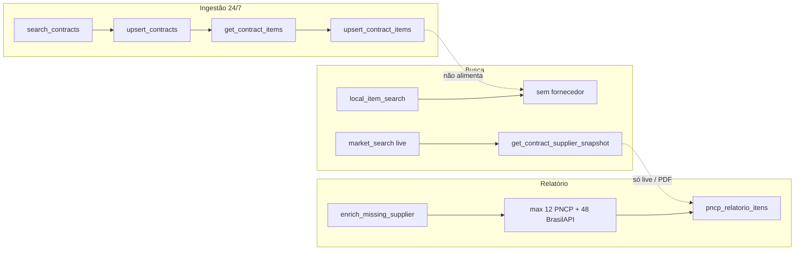

# Plano — Módulo Cobertura de Fornecedor (PNCP / Relatório de Pesquisa de Preços)

**Status:** Fase A implementada no repositório (jun/2026); Fases B–F pendentes  
**Data:** junho/2026  
**Meta operacional:** elevar de ~20% para **70–90%** a identificação de fornecedor (razão social + CNPJ) nos itens **elegíveis**, alinhando busca manual, busca com I.A. e Relatório de Pesquisa de Preços.

---

## 1. Problema e objetivo de negócio

No Relatório de Pesquisa de Preços, muitas linhas exibem preço e referência de contratação PNCP, mas **sem fornecedor identificado** (~80% sem razão social + CNPJ utilizáveis). Isso:

- reduz a **validade jurídica** da pesquisa (rastreabilidade do preço praticado);
- gera **retrabalho manual** na cotação;
- desalinha o DocMaster de plataformas que **pré-indexam vencedor por linha de item** e priorizam contratações **homologadas/adjudicadas**.

**Objetivo técnico central:** obter o fornecedor vencedor nas camadas oficiais do PNCP (**por item** e **por compra**), persistir no **índice local SQLite**, e consumir esse dado na busca e no PDF — em vez de depender de poucas chamadas HTTP síncronas no momento do relatório.

---

## 2. Estado atual no repositório (diagnóstico)

### 2.1 O que já existe

| Componente | Comportamento atual |
|------------|---------------------|
| `pncp_researcher_service/app/pncp_client.py` | `get_contract_supplier_snapshot`: GET `/itens` → até **3** itens com `temResultado`/homolog → GET `/itens/{n}/resultados` → fallback `/resultados`; extrai **CNPJ** do JSON; nome via **BrasilAPI**. |
| `pncp_researcher_service/app/service.py` | Busca **ao vivo** (`market_search`): chama `get_contract_supplier_snapshot` **por contrato** (não por linha de item indexada), com timeout do lookup de itens. |
| `backend/app/services/pncp_supplier_enrichment.py` | Cópia síncrona da mesma lógica; `enrich_missing_supplier_fields_for_cotacao` antes do PDF: **max 12** lookups PNCP + **48** BrasilAPI por cotação. |
| `backend/app/services/pncp_relatorio_itens.py` | Lê `source` do item (`fornecedor`, `cnpj_fornecedor`, chaves aninhadas PNCP); índice local CNPJ→nome entre linhas da mesma cotação. |
| `pncp_researcher_service/app/local_index.py` | Tabela `pncp_itens`: descrição, valores, `raw_json_zlib` do endpoint **`/itens`** (catálogo). **Sem colunas de fornecedor.** |
| Backfill 24/7 | `upsert_contract_items` após `get_contract_items` — **não** chama `/resultados`. |
| `market_search_intelligent` | Fonte principal: `local_item_search` — **sem fornecedor**; fallback híbrido ao vivo só se poucos resultados locais. |
| `PncpFornecedorCadastro` (Django) | Cadastro **manual** por usuário (cotação direta), não cache global PNCP. |

### 2.2 Causas prováveis dos ~20%

1. **Persistência:** índice local não guarda vencedor; busca inteligente e manual indexada não carregam fornecedor.
2. **Granularidade:** snapshot atual é **por compra** (primeiro item com resultado), não **por `numero_item`** da linha cotada.
3. **Momento:** enriquecimento concentrado no PDF com **teto baixo** de HTTP e timeouts curtos (`_DEFAULT_TIMEOUT` ~2,4s).
4. **Elegibilidade:** não há filtro sistemático “só homologado/adjudicado” na ingestão nem flag `fornecedor_elegivel` no índice.
5. **Duplicação de código:** lógica de extração em `pncp_client.py` e `pncp_supplier_enrichment.py` — divergência futura provável.

### 2.3 Fluxo atual (resumo)



---

## 3. Escopo do módulo

### Dentro do escopo

- Resolver fornecedor vencedor (CNPJ + razão social) por **linha de item** quando a API PNCP permitir.
- Camadas PNCP: `/v1/orgaos/{cnpj}/compras/{ano}/{seq}/itens/{n}/resultados`, `/resultados`, metadados de **situação** (compra e item).
- Persistência em SQLite (`pncp_itens` + cache CNPJ).
- Expor fornecedor em `local_item_search`, `market_search_intelligent` e payload ao adicionar item à cotação Django.
- Job de **reprocessamento** (backfill de fornecedor em registros antigos).
- **Indicador de cobertura** (métricas operacionais + endpoint stats).
- Ajuste de `pncp_supplier_enrichment`: priorizar índice local / researcher; HTTP PNCP só como fallback.
- Filtro de **elegibilidade** por situação da compra/item (configurável).

### Fora do escopo (fase 1)

- Substituir BrasilAPI por outra fonte cadastral.
- Enriquecer telefone/e-mail do fornecedor além do que BrasilAPI já devolve (pode reutilizar `fornecedor_cadastro` existente).
- Alterar layout do PDF além de preencher campos já previstos.
- Migrar índice para Postgres (permanece SQLite no researcher).

---

## 4. Modelo de dados proposto (SQLite)

### 4.1 Migração `pncp_itens`

Novas colunas (nomes sugeridos):

| Coluna | Tipo | Descrição |
|--------|------|-----------|
| `cnpj_fornecedor` | TEXT | CNPJ formatado ou dígitos |
| `fornecedor` | TEXT | Razão social (PNCP ou BrasilAPI) |
| `fornecedor_fonte` | TEXT | `pncp_resultado_item`, `pncp_resultado_compra`, `brasilapi`, `pncp_nome_inline` |
| `situacao_item` | TEXT | ex. `Homologado` |
| `situacao_compra` | TEXT | cópia de `pncp_contratos.situacao` ou denormalizado |
| `fornecedor_elegivel` | INTEGER | 0/1 — elegível para relatório |
| `fornecedor_resolvido_at` | TEXT | ISO UTC |
| `resultados_raw_zlib` | BLOB | opcional: JSON compactado de `/resultados` do item |

Índices: `(fornecedor_elegivel, cnpj_fornecedor)`, `(numero_pncp, numero_item)`.

### 4.2 Tabela `pncp_fornecedor_cache`

| Coluna | Tipo |
|--------|------|
| `cnpj_digits` | TEXT PRIMARY KEY |
| `razao_social` | TEXT |
| `nome_fantasia` | TEXT |
| `cadastro_json` | TEXT |
| `updated_at` | TEXT |
| `fonte` | TEXT default `brasilapi` |

TTL configurável (ex. 90 dias) — revalidar sob demanda no reprocess.

### 4.3 Contrato `pncp_contratos` (opcional fase 1b)

Campos denormalizados de vencedor **nível compra** (`cnpj_fornecedor_compra`, `fornecedor_compra`) para fallback quando item não tem resultado mas compra sim.

---

## 5. Algoritmo de resolução (fonte única)

Extrair para módulo compartilhado (recomendado: `pncp_researcher_service/app/supplier_resolver.py`; Django importa via pacote comum ou HTTP interno — **evitar terceira cópia**).

### 5.1 Ordem de precedência por item

1. **GET** `.../itens/{numero_item}/resultados`  
   - Extrair CNPJ (`_walk_supplier_candidates` / `_extract_supplier_cnpj_only`).  
   - Se vier `nomeRazaoSocialFornecedor` / `razaoSocial` no JSON, usar como nome (**fonte `pncp_resultado_item`**).
2. Se item sem resultado mas compra homologada: **GET** `.../resultados` e mapear entrada cujo `numeroItem` coincide (se API estruturar assim); senão vencedor global da compra (**`pncp_resultado_compra`**).
3. Campos inline no payload `/itens` (alguns registros trazem NI fornecedor na linha).
4. **BrasilAPI** só se CNPJ conhecido e nome ausente ou genérico (**`brasilapi`**), via `pncp_fornecedor_cache`.

### 5.2 Elegibilidade (`fornecedor_elegivel = 1`)

Regra inicial (config `PNCP_SUPPLIER_ELIGIBLE_SITUATIONS`, lista CSV):

- **Compra:** contém `homolog`, `adjudic`, `encerr` (ajustar com amostra real do índice).
- **Item:** `temResultado == true` OU situação do item com `homolog` / `adjudic`.
- **Excluir:** compras apenas “Em andamento”, “Revogada”, “Anulada” (lista negativa separada).

Itens **não elegíveis** não entram na meta de 70–90%, mas podem guardar fornecedor para exibição futura.

### 5.3 Priorização de itens no backfill

Reutilizar scoring já existente em `_extract_item_numbers_prioritized` (`temResultado` + homolog). No backfill de fornecedor, processar primeiro itens com maior score; limitar paralelismo (`PNCP_SUPPLIER_FETCH_CONCURRENCY`, default 6–8) para não saturar PNCP.

---

## 6. Mudanças por componente

### 6.1 `pncp_researcher_service`

| Área | Mudança |
|------|---------|
| **Ingestão** | Após `upsert_contract_items`, fila opcional `enrich_suppliers_for_contract(raw)` (feature flag `PNCP_INGEST_ENRICH_SUPPLIER`). |
| **Backfill dedicado** | Endpoint `POST /api/pncp-research/local-index/enrich-suppliers` — pagina contratos/itens sem `fornecedor_resolvido_at`, watermark em `pncp_ingest_state` ou tabela `pncp_supplier_enrich_state`. |
| **Busca** | `_row_to_local_item` / `local_item_search` incluem `fornecedor`, `cnpj_fornecedor`, `fornecedor_elegivel`. |
| **IA** | `market_search_intelligent` herda campos do índice; híbrido live só preenche lacunas. |
| **Live search** | Remover ou reduzir `get_contract_supplier_snapshot` por página quando índice tiver cobertura; manter fallback. |
| **Stats** | `local_index_stats` + `operational-status`: `itens_com_fornecedor`, `itens_elegiveis`, `cobertura_pct`, `cache_brasilapi_hits`. |
| **Config** | Ver secção 8. |

### 6.2 `backend` — `pncp_supplier_enrichment.py`

1. Consultar researcher: `GET .../local-index/item-supplier?numero_pncp=&numero_item=` **ou** leitura direta se volume SQLite montado no backend (hoje **não** — preferir API researcher).
2. Se vazio e elegível: fallback HTTP PNCP (limites maiores só no job assíncrono, não no PDF).
3. `enrich_missing_supplier_fields_for_cotacao`:  
   - Primeiro: preencher de índice (sem limite de linhas).  
   - Depois: até N lookups live (configurável, default 12 mantido no PDF).

### 6.3 `backend` — cotação e relatório

- Ao **adicionar item** da busca (`pncp_cotacao_api` / proxy researcher): gravar `fornecedor`, `cnpj_fornecedor`, `fornecedor_fonte_nome` no JSON `source` do `PncpCotacaoItemCotacao`.
- `pncp_relatorio_itens.py`: sem mudança estrutural se `source` vier completo; validar testes de regressão PDF.

### 6.4 Frontend (fase 2 leve)

- Busca manual / inteligente: coluna ou badge “Fornecedor” quando presente.
- Relatório: já consome API — ganho automático se backend preencher.

### 6.5 Operação / deploy

- Script opcional `scripts/run-pncp-supplier-enrich-loop.sh` (paralelo ao ingest de contratos, menor frequência).
- Documentar em `docs/deploy/PNCP-INGESTAO-INDEX-24-7.md` e `PNCP-API-INDICE-LOCAL.md`.
- Compose: env vars no `docker-compose.pncp.yml`.

---

## 7. Fases de implementação

### Fase A — Fundação (schema + resolver + cache) ✅

- [x] Migração SQLite + `ensure_local_index` idempotente (`_migrate_pncp_itens_supplier_columns`)  
- [x] `supplier_resolver.py` + testes em `pncp_researcher_service/tests/`  
- [x] `fornecedor_cache.py` + tabela `pncp_fornecedor_cache`  
- [x] `supplier_coverage_stats()` em `local_index_stats` → chave `fornecedor`  
- [x] `pncp_client.py` delega extração ao resolver  

**Entregável:** resolver testável offline; cobertura no índice ainda 0% até Fase B/C.

```bash
cd pncp_researcher_service && python -m unittest discover -s tests -v
```

### Passo 3 — Enriquecer ao adicionar fonte à cotação ✅

- [x] `enrich_supplier_fields_in_payloads` — PNCP `/itens/{n}/resultados` por `numero_item` se payload sem CNPJ/nome  
- [x] Hook em `pncp_research_sessions_item_cotacoes` (POST fontes) e `add_items`  
- [x] Settings: `PNCP_ADD_SOURCE_ENRICH_SUPPLIER`, `PNCP_ADD_SOURCE_MAX_PNCP_LOOKUPS` (24), `PNCP_ADD_SOURCE_MAX_BRASILAPI_LOOKUPS` (48)  

### Passo 2 — Busca local / IA com fornecedor do índice (sem alterar ingestão) ✅

- [x] `_supplier_fields_from_local_row` — lê `raw_json_zlib` + colunas `pncp_itens` via `supplier_resolver`  
- [x] `local_item_search` / `market_search_intelligent` expõem `cnpj_fornecedor`, `fornecedor`, …  
- [x] Híbrido: se item local sem CNPJ e live tiver, preenche na mesma chave  
- [x] Django `_SOURCE_KEEP_KEYS` preserva fornecedor ao adicionar item/cotação  

### Passo 1 — Fornecedor por linha de item (sem alterar ingestão) ✅

- [x] `get_contract_supplier_snapshot(..., numero_item=, situacao_compra=)` — researcher  
- [x] `get_contract_supplier_snapshot_sync` + cache `(órgão, ano, seq, numero_item)` — Django PDF/cotação  
- [x] Busca ao vivo: `numero_item` da linha que melhor casa com o termo em `/itens`  

**Escopo do cliente:** não muda backfill 24/7; melhora encontrar CNPJ no momento da busca/enrichment.

### Fase B — Ingestão no caminho quente (opcional / fora do escopo atual)

- [ ] Hook pós-`upsert_contract_items` no backfill (flag desligada por default em dev)  
- [ ] Rate limit + semáforo + logging por contrato  
- [ ] Preencher colunas novas em `pncp_itens`  

**Entregável:** novos itens ingeridos já com fornecedor quando API cooperar.

### Fase C — Job de reprocessamento

- [ ] Endpoint + script loop 24/7 (watermark, `max_contratos` por tick)  
- [ ] Priorizar UF/modalidade com maior volume de cotações DocMaster (opcional)  

**Entregável:** índice histórico (~600k+ itens) sobe cobertura ao longo de dias.

### Fase D — Busca e alinhamento manual × IA

- [ ] `local_item_search` / `market_search_intelligent` expõem fornecedor  
- [ ] Django persiste `source` completo ao importar da busca  
- [ ] Reduzir chamadas live em `service.py`  

**Entregável:** mesma referência na busca manual e na recomendação IA.

### Fase E — PDF e enrichment

- [ ] `enrich_missing_supplier_fields_for_cotacao` lê índice primeiro  
- [ ] Métricas no `operational-status` e painel Grafana (opcional: contador Prometheus no researcher)  

**Entregável:** relatório com meta 70–90% em itens elegíveis de cotações típicas.

### Fase F — Endurecimento

- [ ] Testes integração researcher  
- [ ] Testes Django `pncp_relatorio_itens` / PDF smoke  
- [ ] Runbook + entrada em `ENTREGA-MODULOS.md` como Módulo 3  

---

## 8. Configuração sugerida

| Variável | Default | Descrição |
|----------|---------|-----------|
| `PNCP_INGEST_ENRICH_SUPPLIER` | `false` → `true` em prod após validação | Enriquecer no backfill de itens |
| `PNCP_SUPPLIER_FETCH_CONCURRENCY` | `6` | Paralelismo GET resultados |
| `PNCP_SUPPLIER_FETCH_TIMEOUT` | `12` | Timeout por request |
| `PNCP_SUPPLIER_ELIGIBLE_SITUATIONS` | `homolog,adjudic,encerr` | Substrings situação compra |
| `PNCP_SUPPLIER_SKIP_SITUATIONS` | `revog,anul,cancel` | Excluir da meta |
| `PNCP_BRASILAPI_CACHE_DAYS` | `90` | TTL cache SQLite |
| `PNCP_SUPPLIER_REPROCESS_BATCH` | `40` | Contratos por tick do job |
| `PNCP_SUPPLIER_MAX_ITENS_PER_CONTRACT` | `20` | Teto de GETs `/resultados` por compra |

---

## 9. Métricas e aceite

### 9.1 Indicadores

```text
cobertura_global = itens com cnpj_fornecedor / total pncp_itens
cobertura_elegivel = itens elegíveis com fornecedor / itens elegíveis
```

Expor em:

- `GET /api/pncp-research/local-index/stats` (campos novos)
- `GET .../operational-status` (alerta se `cobertura_elegivel < 0.5` após 7 dias de job)

### 9.2 Critérios de aceite (produto)

| # | Critério |
|---|----------|
| 1 | Amostra de 100 itens **elegíveis** aleatórios do índice: ≥70% com CNPJ + razão social não genérica |
| 2 | Cotação criada só por busca inteligente: ≥70% das linhas importadas com fornecedor no `source` sem abrir PDF |
| 3 | Geração de PDF: `enrich_missing_supplier_fields_for_cotacao` faz **&lt;5** chamadas PNCP na mediana (índice pré-populado) |
| 4 | Busca manual e IA retornam o **mesmo** `cnpj_fornecedor` para o mesmo `(numero_pncp, numero_item)` |
| 5 | Job de reprocessamento retomável (watermark) sem duplicar writes |

### 9.3 Query de auditoria (SQLite)

```sql
SELECT
  COUNT(*) AS total,
  SUM(CASE WHEN TRIM(COALESCE(cnpj_fornecedor,'')) != '' THEN 1 ELSE 0 END) AS com_cnpj,
  SUM(CASE WHEN fornecedor_elegivel = 1 THEN 1 ELSE 0 END) AS elegiveis,
  SUM(CASE WHEN fornecedor_elegivel = 1 AND TRIM(COALESCE(cnpj_fornecedor,'')) != '' AND TRIM(COALESCE(fornecedor,'')) != '' THEN 1 ELSE 0 END) AS elegiveis_ok
FROM pncp_itens;
```

---

## 10. Riscos e mitigação

| Risco | Mitigação |
|-------|-----------|
| Rate limit PNCP (429) | Semáforo, backoff, reutilizar `ingest_operational_status` / pausa automática |
| Volume de GETs (600k itens × N resultados) | Job lento em background; não bloquear ingest de contratos; batch + watermark |
| BrasilAPI indisponível | Guardar CNPJ sem nome; retry no reprocess; não falhar ingest |
| Resultado por item vazio com compra homologada | Fallback `/resultados` + flag `fornecedor_fonte` explícita |
| Duplicação código Django/researcher | Pacote compartilhado ou só researcher + API |
| Aumento tamanho SQLite | `resultados_raw_zlib` opcional; só colunas essenciais por default |

---

## 11. Estimativa de esforço (ordem de grandeza)

| Fase | Esforço dev |
|------|-------------|
| A Fundação | 2–3 dias |
| B Ingestão | 2 dias |
| C Reprocessamento | 2 dias + dias de runtime em prod |
| D Busca | 1–2 dias |
| E PDF/enrichment | 1 dia |
| F Testes/docs | 1–2 dias |

**Total implementação:** ~10–12 dias úteis; **cobertura plena do índice histórico** depende do tempo de job em produção (dias a semanas com rate limit).

---

## 12. Referências no código

| Ficheiro | Relevância |
|----------|------------|
| `pncp_researcher_service/app/pncp_client.py` | `get_contract_supplier_snapshot`, BrasilAPI |
| `pncp_researcher_service/app/local_index.py` | Schema `pncp_itens`, backfill |
| `pncp_researcher_service/app/service.py` | Busca live + inteligente |
| `backend/app/services/pncp_supplier_enrichment.py` | Enriquecimento PDF |
| `backend/app/services/pncp_relatorio_itens.py` | Leitura `source` no relatório |
| `backend/app/pncp_relatorio_api.py` | Chama enrichment antes do PDF |
| `docs/PESQUISADOR_PNCP_FUNCIONAMENTO_ATUAL.md` | Visão geral do módulo |
| `docs/deploy/PNCP-API-INDICE-LOCAL.md` | API índice (atualizar após implementação) |

---

## 13. Roteiro «100%» (testes + modificações)

**Definição honesta de 100%:** 100% das fontes em que o PNCP **publica** fornecedor em alguma camada consultável (resultado, contrato, inline). Fontes com `pncp_resultados_204` + `pncp_contrato_404` **não são falha de software** — são lacuna de publicação pelo órgão.

### 13.1 Matriz de testes (ordem de execução)

| # | Teste | Comando / artefato | O que valida |
|---|--------|-------------------|--------------|
| T1 | Unit resolver | `cd pncp_researcher_service && python -m unittest tests.test_supplier_resolver` | Extração JSON `/resultados`, contratos, catálogo |
| T2 | Unit parse NP | `backend/app/tests/test_pncp_supplier_enrichment.py` | `numero_pncp` formato `000085/2025` |
| T3 | Auditoria cotação | `python manage.py audit_pncp_supplier_coverage --cotacao-id N` | Resumo `gap_reason` por fonte |
| T4 | Só faltantes | `... --only-missing` | As 5 linhas sem CNPJ (como na cotação 6) |
| T5 | JSON relatório | `... --json > /tmp/audit.json` | Dashboard / planilha |
| T6 | Amostra índice | Script SQLite 1k itens + probe async | Distribuição 204 vs ok no índice |
| T7 | Regressão PDF | Gerar PDF antes/depois; comparar `sem CNPJ` | Persistência no `source` |

### 13.2 Motivos padronizados (`gap_reason`)

| Código | Significado | Ação |
|--------|-------------|------|
| `ok_ja_no_source` | Já tem CNPJ na cotação | Nenhuma |
| `ok_fornecedor_resolvido` | Probe encontrou na API | Persistir se ainda não no source |
| `missing_pncp_keys` | Sem `numero_pncp`/ano/seq | Corrigir payload na busca |
| `pncp_resultados_204` | Item/compra sem resultado publicado | Aguardar órgão ou trocar fonte |
| `pncp_contrato_404` | Sem contrato publicado | Idem |
| `pncp_contrato_200_sem_cnpj` | Contrato existe mas JSON sem CNPJ | Revisar parser / amostra real |
| `pncp_catalogo_sem_fornecedor` | Todas as camadas vazias | Idem 204 |

### 13.3 Camadas PNCP (ordem implementada)

1. `GET .../itens/{n}/resultados`  
2. `GET .../resultados` (compra)  
3. `GET .../itens/{n}` (inline)  
4. **`GET .../contratos/contratacao/{ano}/{seq}`** (novo fallback jun/2026)  
5. BrasilAPI se só CNPJ  

### 13.4 Modificações por fase (caminho a cobertura máxima)

| Fase | Entrega | Impacto |
|------|---------|---------|
| **R0** (feito) | Auditoria `audit_pncp_supplier_coverage`, probe, limites PDF 96, parse `.../2025` | Entender **por que** cada linha falha |
| **R1** | Fallback contratos em `pncp_client` + `pncp_supplier_enrichment` | +% onde há contrato sem `/resultados` |
| **R2** | Fase B ingestão: gravar `/resultados` no índice | Busca manual já com fornecedor |
| **R3** | Job reprocessamento só elegíveis homologados | Índice histórico |
| **R4** | UI: badge `gap_reason` ao adicionar fonte | Usuário não adiciona fonte 204 |
| **R5** | PDF: «Não publicado no PNCP (204)» | Relatório explícito |

### 13.5 Comando no DESKTOP (após deploy)

```bash
docker exec backend python manage.py audit_pncp_supplier_coverage --cotacao-id 6 --only-missing
docker exec backend python manage.py audit_pncp_supplier_coverage --cotacao-id 6 --json
```

Deploy dos ficheiros novos: `pncp_supplier_enrichment.py`, `pncp_supplier_gap_audit.py`, `audit_pncp_supplier_coverage.py`, `pncp_client.py`, `supplier_resolver.py`, `supplier_probe.py` (researcher).

---

## 14. Próximo passo recomendado

1. Rodar **T3/T4** nas cotações 3 e 6 e guardar JSON.  
2. Medir % `pncp_resultados_204` vs `ok_*` — define teto realista.  
3. Aprovar **R2** (ingestão) se o teto for insuficiente sem reprocessar índice.  

---

*Documento de planejamento — atualizar para “implementado” em `ENTREGA-MODULOS.md` quando as fases A–E estiverem concluídas.*
