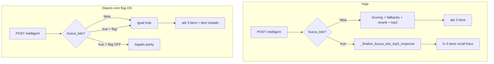

# Implementação — paridade IA cotação inteira ↔ item isolado

Runbook para aplicar modificações com **rollback fácil** e **checkpoints de aprovação** antes de cada fase.

**Contexto:** [`PNCP-ANALISE-CODIGO-IA-ITEM-VS-LOTE.md`](PNCP-ANALISE-CODIGO-IA-ITEM-VS-LOTE.md)  
**Notas:** [`PNCP-NOTAS-PENDENCIAS.md`](PNCP-NOTAS-PENDENCIAS.md)

---

## Objetivo

Autostart / busca da **cotação inteira** (`busca_lote: true`) entregar **até 3 cotações** com a **mesma positividade** que «Buscar preços com I.A para este item» (`busca_lote: false`).

**Não alterar** o fluxo `?itemId=` enquanto a flag legado estiver disponível.

---

## Diagrama — antes vs depois



---

## Princípios de segurança

| Regra | Motivo |
|-------|--------|
| Feature flag `PNCP_BULK_USE_INTELLIGENT_PIPELINE` | Rollback = env `0`, sem revert de código |
| Default flag **`0`** até aprovação pós-teste | Produção não muda sozinha no deploy |
| Qwen/resumo **off** no lote | Já é default; não ligar |
| Enrich cap **3** no lote | Tempo previsível |
| PR 1 = só `pncp_researcher_service` | Frontend/Django intactos |
| Testes golden antes de flag `1` em DESKTOP | Paridade código |

---

## Variáveis novas / ajustadas

Adicionar em `pncp_researcher_service/app/config.py` e `docker-compose.pncp.yml`:

| Variável | Default | Função |
|----------|---------|--------|
| `PNCP_BULK_USE_INTELLIGENT_PIPELINE` | **`0`** | `1` = lote usa motor do item isolado |
| `PNCP_BULK_SEARCH_SQL_LIMIT` | manter `200` → subir para **`2000`** quando flag ON (opcional fase 2) | Recall FTS no lote |
| `PNCP_BULK_SEARCH_MAX_SECONDS` | `90` → **`120`** quando flag ON (opcional) | Menos timeout vazio |
| `PNCP_BULK_ENRICH_HOMOLOG_MAX` | `3` | Já ok |
| `PNCP_IA_RERANK_BULK_ENABLED` | `0` | Manter off |

Expor no funil: `bulk_intelligent_pipeline: true/false`.

---

## Fases de implementação

### Fase 0 — Preparação (sem mudar comportamento)

**Arquivos:** nenhum comportamento alterado; só doc + branch.

| # | Tarefa | Arquivo |
|---|--------|---------|
| 0.1 | Branch `feat/pncp-bulk-intelligent-pipeline` | git |
| 0.2 | Este runbook aprovado | `docs/PNCP-IMPLEMENTACAO-PARIDADE-LOTE.md` |

**CHECKPOINT 0 — Aprovação:** você confirma que o escopo e a estratégia de flag estão ok para codar.

---

### Fase 1 — Flag + gate no early return (comportamento idêntico ao hoje)

**Objetivo:** infra de toggle; **zero** mudança com flag `0`.

| # | Tarefa | Arquivo | Detalhe |
|---|--------|---------|---------|
| 1.1 | `PNCP_BULK_USE_INTELLIGENT_PIPELINE: bool = _env_bool(..., False)` | `config.py` | Default **False** |
| 1.2 | Import da flag | `service.py` | |
| 1.3 | Substituir bloco ~2591–2607 por: | `service.py` | ver snippet abaixo |
| 1.4 | Env no compose | `docker-compose.pncp.yml` | `PNCP_BULK_USE_INTELLIGENT_PIPELINE=0` |
| 1.5 | Teste: flag off = resposta igual | `tests/test_bulk_search_lote.py` | mock ou assert `modo_resposta` legado |

**Snippet lógico (service.py ~2591):**

```python
use_bulk_intelligent = busca_lote and PNCP_BULK_USE_INTELLIGENT_PIPELINE
funil["bulk_intelligent_pipeline"] = bool(use_bulk_intelligent)

if busca_lote and not PNCP_BULK_USE_INTELLIGENT_PIPELINE:
    return await _finalize_busca_lote_top3_response(...)
# else: cai no _score_candidates (motor individual)
```

**CHECKPOINT 1 — Aprovação:** rodar testes locais; deploy DESKTOP com flag **0**; confirmar autostart **igual** ao de hoje.

```bash
cd pncp_researcher_service && PYTHONPATH=. python -m unittest tests.test_bulk_search_lote -v
```

---

### Fase 2 — Ajustes do loop pré-scoring (só quando flag ON)

**Objetivo:** recall/híbrido alinhados ao individual **sem** duplicar código do finalize.

| # | Tarefa | Onde | Comportamento |
|---|--------|------|---------------|
| 2.1 | SQL limit | `service.py` ~2380 | Se `use_bulk_intelligent`: `limit = min(limit, max(2000, PNCP_BULK_SEARCH_SQL_LIMIT))` ou remover cap |
| 2.2 | Break termos | ~2431 | Se `use_bulk_intelligent`: **não** usar `priced_n >= 1`; manter `priced_n >= 3` ou break após N termos |
| 2.3 | Híbrido | ~2459 | Se `use_bulk_intelligent`: `need_hybrid = local_priced < hybrid_min` (igual individual) |
| 2.4 | Filtro fornecedor local | ~2402 | Se `use_bulk_intelligent`: `filtrar_fornecedor_para_exibicao=True` |
| 2.5 | Enrich loop local | ~2411 | Se `use_bulk_intelligent`: `PNCP_BULK_LOCAL_ENRICH_HOMOLOG_MAX=0` (enrich só no top3) |

**CHECKPOINT 2 — Aprovação:** flag **1** em dev/staging; 1 item conhecido (ex. termo do item 13871): comparar 3 PNCP isolado vs lote.

---

### Fase 3 — Caps no finalize inteligente (flag ON)

**Objetivo:** lote percorre `_score_candidates` → top3, mas **não** explode tempo.

| # | Tarefa | Onde | Detalhe |
|---|--------|------|---------|
| 3.1 | `funil["modo_resposta"]` | fim do pipeline | `"bulk_intelligent_top3"` quando flag ON |
| 3.2 | Enrich top3 | ~3074 | Já cap `PNCP_BULK_ENRICH_HOMOLOG_MAX=3` quando `busca_lote` |
| 3.3 | IA resumo | `_ia_resumo_on_for_request` | Já off no lote |
| 3.4 | Qwen | `_ia_rerank_on_for_request` | Manter off (`PNCP_IA_RERANK_BULK_ENABLED=0`) |
| 3.5 | Local rerank | ~2918 | Manter on (sem LLM) |
| 3.6 | Timeout API | `api.py` ~131 | Se flag ON: `tmo = max(120, PNCP_BULK_SEARCH_MAX_SECONDS)` |

**CHECKPOINT 3 — Aprovação:** autostart parcial (10–20 itens) no DESKTOP; medir tempo/item e % com ≥1 preço.

---

### Fase 4 — Testes de regressão

| # | Teste | Arquivo |
|---|-------|---------|
| 4.1 | Golden: mesmo termo, `busca_lote` false vs true+flag → mesmos 3 `numero_pncp` | `tests/test_bulk_search_lote.py` |
| 4.2 | Flag off → `modo_resposta == busca_lote_top3_parity` | idem |
| 4.3 | Flag on → `bulk_intelligent_pipeline == true`, `top3_final >=` isolado | idem |
| 4.4 | Suite existente busca inteligente | `tests/test_pricing_display.py`, etc. |

```bash
cd pncp_researcher_service
PYTHONPATH=. python -m unittest discover -s tests -p 'test_bulk*.py' -v
```

**CHECKPOINT 4 — Aprovação:** CI/local verde; você autoriza flag **1** em DESKTOP produção.

---

### Fase 5 — Deploy DESKTOP

| # | Comando / ação |
|---|----------------|
| 5.1 | `git pull` no host |
| 5.2 | `./scripts/deploy-pncp-researcher-code.sh` |
| 5.3 | Confirmar env: `PNCP_BULK_USE_INTELLIGENT_PIPELINE=0` primeiro |
| 5.4 | Smoke: 1× POST intelligent `busca_lote:false` + 1× `busca_lote:true` (flag 0) |
| 5.5 | Subir flag: `PNCP_BULK_USE_INTELLIGENT_PIPELINE=1` + recreate container |
| 5.6 | Smoke autostart cotação pequena (5 itens) |

**Rollback imediato:**

```bash
# no compose ou .env do pncp
PNCP_BULK_USE_INTELLIGENT_PIPELINE=0
docker compose -f docker-compose.pncp.yml up -d --force-recreate pncp_researcher_service
```

**CHECKPOINT 5 — Aprovação:** cotação real (ou amostra acordada) ok; manter flag 1 ou voltar 0.

---

### Fase 6 — Frontend (opcional, após backend estável)

| # | Tarefa | Arquivo | Prioridade |
|---|--------|---------|------------|
| 6.1 | Autostart: UF por item (como `?itemId=`) | `BuscaInteligenteCotacoes.vue` | Média |
| 6.2 | `BULK_SEARCH_TIMEOUT_MS` 95000 → 120000 se flag ON | idem | Baixa |
| 6.3 | `BULK_CONCURRENCY=2` | idem | Só após tempo aceitável |

**CHECKPOINT 6 — Aprovação:** só se Fase 5 estável ≥48h.

---

### Fase 7 — Limpeza (opcional, futuro)

- Depreciar `_finalize_busca_lote_top3_response` (manter 1 release com flag legado).
- Default flag → `1`.
- Remover código morto.

**Não fazer** até CHECKPOINT 5 aprovado em produção.

---

## Mapa de arquivos tocados

```
pncp_researcher_service/app/config.py          # flag + docs env
pncp_researcher_service/app/service.py         # gate, loop, funil
pncp_researcher_service/app/api.py             # timeout (opcional)
pncp_researcher_service/tests/test_bulk_search_lote.py
docker-compose.pncp.yml                      # env default 0
docs/PNCP-NOTAS-PENDENCIAS.md                  # status pós-deploy
```

**Não tocar na Fase 1–5:**

- `frontend-vue/` (exceto Fase 6)
- `backend/` Django
- Índice / ingest

---

## Critérios de aceite (definição de pronto)

- [ ] Flag `0`: comportamento **byte-a-byte equivalente** ao atual (modo legado).
- [ ] Flag `1`: para termo/faixa/UF fixos, lote retorna **≥** isolado em quantidade e **⊇** em `{numero_pncp, numero_item}`.
- [ ] Item isolado (`busca_lote:false`) **inalterado** em testes golden.
- [ ] Autostart 696 itens: tempo documentado (meta negociável: ≤2× tempo atual **com** ≥ mesma taxa de itens com 3 preços).
- [ ] Rollback testado (flag 0 em &lt;2 min).

---

## Checklist de permissão (para você)

Marque mentalmente ou no PR antes de cada etapa:

| Checkpoint | Pergunta | Quem aprova |
|------------|----------|-------------|
| **0** | Escopo + flag ok? | Você |
| **1** | Código flag OFF = zero mudança? | Você + testes |
| **2** | 1 item golden paridade com flag ON? | Você |
| **3** | Autostart parcial tempo/qualidade ok? | Você |
| **4** | Testes CI verdes? | Você |
| **5** | Deploy DESKTOP + flag 1 em produção? | Você |
| **6** | Frontend/concorrência? | Você (opcional) |

**Para o agente continuar implementação:** responda explicitamente, por exemplo:

> «Aprovado CHECKPOINT 0, pode implementar Fase 1»

ou

> «Implemente Fases 1–4; pare antes do deploy (CHECKPOINT 5)»

Sem essa frase, **não** alterar produção nem default da flag para `1`.

---

## Ordem de execução recomendada (uma linha)

```
Fase 0 → 1 (flag gate) → [CHECKPOINT 1] → 2 (loop) → 3 (caps) → 4 (testes) → [CHECKPOINT 4] → 5 (deploy flag 0, depois 1) → [CHECKPOINT 5] → 6 opcional → 7 futuro
```

---

## Estimativa de esforço

| Fase | Esforço |
|------|---------|
| 1 | ~2–3 h |
| 2–3 | ~4–6 h |
| 4 | ~2–3 h |
| 5 deploy | ~30 min |
| 6 frontend | ~2–4 h |
| **Total backend paridade** | **~1–1,5 dia** |

---

*Criado: 2026-06-22 — aguardando CHECKPOINT 0 para codar.*
