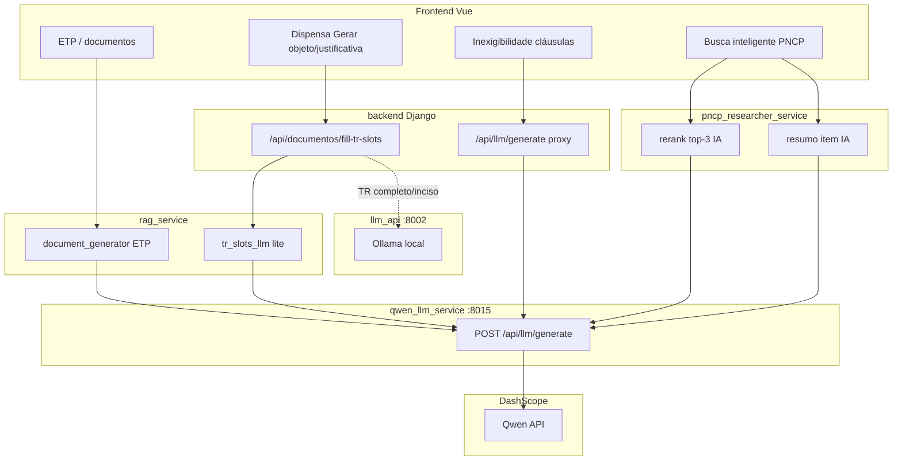

# Integração Qwen (API externa) no DocMaster

**Status:** código preparado no repositório; **produção depende de `QWEN_API_KEY` válida** e do serviço `qwen_llm_service` em execução.

**Última revisão:** junho/2026

---

## 1. Resumo executivo

O DocMaster usa **dois backends de geração de texto**:

| Backend | Onde roda | Quando |
|---------|-----------|--------|
| **Ollama local** | `llm_api:8002` → container `ollama` | TR completo, inciso, agent, RAG genérico, sanitização |
| **Qwen cloud** | `qwen_llm_service:8015` → DashScope (API OpenAI-compatible) | ETP, objeto/justificativa, busca PNCP com IA |

O `qwen_llm_service` é um **gateway FastAPI** com o **mesmo contrato** que o `llm_api`:

```http
POST /api/llm/generate
Content-Type: application/json

{"prompt": "...", "stream": false, "model": "opcional"}
```

Resposta:

```json
{
  "ok": true,
  "data": { "response": "...", "model": "...", "done": true },
  "token_usage": { "prompt_tokens": 0, "completion_tokens": 0, "total_tokens": 0 }
}
```

**Bloqueio atual típico:** sem `QWEN_API_KEY` no `.env` da VPS, o gateway responde `503` com `"QWEN_API_KEY não configurada."` e todos os fluxos que apontam para `:8015` falham (ou caem no fallback se a URL estiver vazia).

---

## 2. Arquitetura



---

## 3. Fluxos que usam Qwen (implementado no código)

### 3.1 ETP — Estudo Técnico Preliminar

| Item | Valor |
|------|-------|
| **Serviço consumidor** | `rag_service` |
| **Código** | `rag_service/app/document_generator.py` → `llm_generation_base_url_for_document_type()` |
| **Env** | `LLM_ETP_GENERATION_BASE_URL=http://qwen_llm_service:8015` |
| **Compose** | `docker-compose.yml` → serviço `rag_service` |
| **Disparo** | Geração de cláusulas/listas/tabelas de documentos tipo ETP |

### 3.2 Objeto + justificativa — dispensa / inexigibilidade

Dois caminhos no frontend:

#### A) Dispensa normal/rápida — botão «Gerar objeto e justificativa»

| Item | Valor |
|------|-------|
| **Endpoint** | `POST /api/documentos/fill-tr-slots` (Django) → `POST /api/rag/fill-tr-slots` (rag) |
| **Modo** | `lite_fill` em `tr_slots_llm.py` (`use_clausulas_gateway=True`) |
| **Env rag** | `LLM_CLAUSULAS_GENERATION_BASE_URL=http://qwen_llm_service:8015` |
| **Roteamento** | Só pacotes `dispensa_*` / `inexigibilidade_*` (`slot_package_key` no context) |
| **Ollama continua** | Inciso LLM, itens[], seção 4, TR integral |

#### B) Inexigibilidade (e algumas dispensa) — `clausulasObjetoJustificativa.js`

| Item | Valor |
|------|-------|
| **Endpoint** | `POST /api/llm/generate` (proxy Django) |
| **Código** | `backend/app/llm_proxy.py` → `_llm_base_url_for_proxy()` |
| **Env backend** | `LLM_CLAUSULAS_API_BASE_URL=http://qwen_llm_service:8015` |
| **Timeout proxy** | `LLM_CLAUSULAS_PROXY_TIMEOUT=180` (default) |
| **Identificação pacote** | `slot_package_key` no JSON ou inferido do `Referer` |

### 3.3 Pesquisa de preços PNCP — busca inteligente com IA

| Item | Valor |
|------|-------|
| **Serviço** | `pncp_researcher_service` (stack **separada** `docker-compose.pncp.yml`) |
| **Código** | `pncp_researcher_service/app/service.py` → `_ia_post_generate()` |
| **Usos** | (1) **Rerank** — escolhe top 3 entre ~36 candidatos; (2) **Resumo** — 1 frase `ia_interpretacao_item` |
| **Env** | `PNCP_IA_BASE_URL=http://qwen_llm_service:8015` |
| **Timeouts** | `PNCP_IA_TIMEOUT_SECONDS=22`, `PNCP_IA_ITEM_RESUMO_TIMEOUT_SECONDS=18` |
| **Health** | `GET /api/pncp-research/health` → campo `ia.base_url` |

**Importante:** o PNCP researcher só está na rede **`docmaster_net`**. O `qwen_llm_service` precisa estar nessa rede (configurado no `docker-compose.yml` principal).

**Modo qualidade (tiers rígidos, rerank no pool misto, cap de similares):** ver [PNCP-BUSCA-INTELIGENTE-QUALIDADE.md](./PNCP-BUSCA-INTELIGENTE-QUALIDADE.md).

---

## 4. O que ainda falta resolver (API Qwen)

Checklist antes de considerar Qwen «ligado» em produção:

### 4.1 Conta e chave API

- [ ] Criar conta / projeto no [Alibaba Cloud DashScope](https://dashscope.aliyun.com/) (ou provedor compatível).
- [ ] Gerar **API Key** com permissão para modelos chat (ex.: `qwen-plus`, `qwen3.6-plus`).
- [ ] Confirmar **modelo disponível** na região da conta (`QWEN_MODEL` no compose).
- [ ] Verificar **billing / quota** (requests por minuto, tokens/dia).

### 4.2 Configurar na VPS

- [ ] Colocar a chave no `.env` **na pasta do compose principal** (ex.: `/home/docmaster/.env`):

```env
QWEN_API_KEY=sk-xxxxxxxxxxxxxxxx
QWEN_API_BASE_URL=https://dashscope.aliyuncs.com/compatible-mode/v1
QWEN_MODEL=qwen-plus
# ou qwen3.6-plus — deve existir na conta
QWEN_DAILY_TOKEN_BUDGET=500000
```

- [ ] Subir o gateway:

```bash
docker compose --profile qwen up -d --build qwen_llm_service
```

- [ ] Validar que a chave entrou no container (comprimento > 0, **nunca** imprimir a chave):

```bash
docker compose exec -T qwen_llm_service sh -c 'test -n "$QWEN_API_KEY" && echo OK || echo VAZIA'
```

### 4.3 Teste direto no provider (fora do DocMaster)

```bash
curl -sS -X POST "https://dashscope.aliyuncs.com/compatible-mode/v1/chat/completions" \
  -H "Authorization: Bearer SUA_CHAVE_AQUI" \
  -H "Content-Type: application/json" \
  -d '{"model":"qwen-plus","messages":[{"role":"user","content":"Responda só: OK"}],"max_tokens":8}'
```

Se falhar aqui, o problema é **conta/chave/modelo/região** — não é bug do DocMaster.

### 4.4 Teste no gateway local

```bash
curl -sS http://127.0.0.1:8015/health
curl -sS -X POST http://127.0.0.1:8015/api/llm/generate \
  -H "Content-Type: application/json" \
  -d '{"prompt":"Responda só: OK","stream":false}'
```

### 4.5 Recriar consumidores após env

```bash
# Stack principal
docker compose up -d --force-recreate rag_service backend

# PNCP (compose separado)
cp docmaster-core/docker-compose.pncp.yml ~/docker-compose.pncp.yml
docker compose -f ~/docker-compose.pncp.yml up -d --force-recreate pncp_researcher_service
```

### 4.6 Conectividade entre stacks

- [ ] Rede `docmaster_net` existe: `docker network inspect docmaster_net`
- [ ] `qwen_llm_service` na rede: `docker inspect qwen_llm_service --format '{{json .NetworkSettings.Networks}}'`
- [ ] Do container PNCP, resolver o hostname:

```bash
docker exec pncp_researcher_service python -c \
  "import socket; print(socket.gethostbyname('qwen_llm_service'))"
```

Se falhar → subir Qwen com profile `qwen` **depois** de `docker network create docmaster_net` (scripts `ensure-docmaster-stack.sh` / `ensure-pncp-researcher.sh` criam a rede).

---

## 5. Matriz completa de variáveis de ambiente

### 5.1 Gateway (`qwen_llm_service`) — `.env` na raiz do compose

| Variável | Obrigatória | Default | Descrição |
|----------|-------------|---------|-----------|
| `QWEN_API_KEY` | **Sim** | vazio | Chave DashScope |
| `QWEN_API_BASE_URL` | Não | `https://dashscope.aliyuncs.com/compatible-mode/v1` | Base OpenAI-compatible |
| `QWEN_MODEL` | Não | `qwen3.6-plus` | Modelo default das chamadas |
| `QWEN_TIMEOUT` | Não | `120` | Timeout HTTP para a API cloud |
| `QWEN_MAX_OUTPUT_TOKENS` | Não | `4096` | Teto de tokens de saída |
| `QWEN_MAX_PROMPT_CHARS` | Não | `120000` | Teto de caracteres no prompt |
| `QWEN_DAILY_TOKEN_BUDGET` | Não | `0` | `0` = sem limite; soma input+output/dia UTC |

Ver também: `qwen_llm_service/.env.example`

### 5.2 `rag_service` — `docker-compose.yml`

| Variável | Default compose | Uso |
|----------|-----------------|-----|
| `LLM_ORCHESTRATION_BASE_URL` | `http://llm_api:8002` | Fallback Ollama |
| `LLM_ETP_GENERATION_BASE_URL` | `http://qwen_llm_service:8015` | ETP |
| `LLM_CLAUSULAS_GENERATION_BASE_URL` | `http://qwen_llm_service:8015` | Objeto/justificativa fill-tr-slots |

Código: `rag_service/app/config.py`

### 5.3 `backend` Django — `docker-compose.yml`

| Variável | Default compose | Uso |
|----------|-----------------|-----|
| `LLM_API_BASE_URL` | `http://llm_api:8002` | Proxy LLM geral |
| `LLM_CLAUSULAS_API_BASE_URL` | `http://qwen_llm_service:8015` | `/api/llm/generate` dispensa/inexig. |
| `LLM_CLAUSULAS_PROXY_TIMEOUT` | `180` | Timeout proxy → Qwen |

Código: `backend/mdlicitatech/settings.py`, `backend/app/llm_proxy.py`

### 5.4 `pncp_researcher_service` — `docker-compose.pncp.yml`

| Variável | Default compose | Uso |
|----------|-----------------|-----|
| `PNCP_IA_BASE_URL` | `http://qwen_llm_service:8015` | Rerank + resumo |
| `PNCP_IA_MODEL` | vazio | Usa default do gateway |
| `PNCP_IA_TIMEOUT_SECONDS` | `22` | Rerank (cloud precisa mais que 4.5s local) |
| `PNCP_IA_ITEM_RESUMO_TIMEOUT_SECONDS` | `18` | Resumo de item |
| `PNCP_IA_RERANK_ENABLED` | `1` | Liga/desliga rerank |
| `PNCP_IA_ITEM_RESUMO_ENABLED` | `1` | Liga/desliga resumo |
| `PNCP_IA_MAX_CANDIDATES` | `36` | Candidatos enviados ao rerank |

Código: `pncp_researcher_service/app/config.py`, `service.py`

---

## 6. Rede Docker

```
┌─────────────────────────────────────────────────────────┐
│  compose principal (docmaster)                          │
│  default network: backend, rag, llm_api, ollama, qwen…  │
│  docmaster_net: backend, qwen_llm_service               │
└─────────────────────────────────────────────────────────┘
                          │
                    docmaster_net (external)
                          │
┌─────────────────────────────────────────────────────────┐
│  compose pncp (docmaster-pncp)                          │
│  pncp_researcher_service → docmaster_net only           │
└─────────────────────────────────────────────────────────┘
```

- **PNCP → Qwen:** hostname `qwen_llm_service:8015` (requer Qwen na `docmaster_net`).
- **rag/backend → Qwen:** mesma rede default do compose principal + hostname `qwen_llm_service`.
- **PNCP → llm_api:** **não funciona** por padrão (`llm_api` não está na `docmaster_net`). Por isso a migração PNCP IA para Qwen também resolve conectividade.

---

## 7. Deploy recomendado (VPS)

Ordem sugerida:

```bash
# 1. .env com QWEN_API_KEY na pasta do compose (~ ou docmaster-core pai)
nano .env

# 2. Rede compartilhada
docker network create docmaster_net 2>/dev/null || true

# 3. Gateway Qwen
cd /caminho/do/deploy
docker compose --profile qwen up -d --build qwen_llm_service

# 4. Consumidores stack principal
docker compose up -d --build rag_service backend

# 5. PNCP (ficheiro separado — copiar do repo após git pull)
cp docmaster-core/docker-compose.pncp.yml ~/docker-compose.pncp.yml
docker compose -f ~/docker-compose.pncp.yml up -d --force-recreate pncp_researcher_service
```

---

## 8. Validação por fluxo

### 8.1 Gateway

```bash
curl -s http://127.0.0.1:8015/health
curl -s http://127.0.0.1:8015/api/llm/usage-today
docker compose logs qwen_llm_service --tail 30
```

Logs de sucesso: `event=qwen_ok`. Erros: `event=qwen_error` em `./qwen_llm_audit/`.

### 8.2 PNCP IA

```bash
curl -s http://127.0.0.1:8012/api/pncp-research/health | python3 -m json.tool
# Esperado: "ia": { "base_url": "http://qwen_llm_service:8015", ... }
```

No site: busca inteligente PNCP → verificar se top 3 parece rerankeado e se itens ambíguos ganham `ia_interpretacao_item`.

### 8.3 Dispensa — objeto/justificativa

Formulário dispensa → «Gerar objeto e justificativa».  
Logs: `docker compose logs rag_service --tail 50` (sem erro de conexão a `:8015`).

### 8.4 Inexigibilidade

Mesmo botão via `/api/llm/generate`.  
Logs: `docker compose logs backend --tail 50`.

### 8.5 ETP

Gerar documento ETP; confirmar qualidade e ausência de timeout.

---

## 9. Erros comuns

| Sintoma | Causa provável | Ação |
|---------|----------------|------|
| `QWEN_API_KEY não configurada` (503) | Env vazia no container | `.env` + recreate `qwen_llm_service` |
| `Não autorizado` (401) | Chave inválida | Testar curl direto DashScope (§4.3) |
| `Rate limit` (429) | Quota / RPM | Aumentar plano ou `QWEN_DAILY_TOKEN_BUDGET` |
| Timeout 504 no frontend | Cloud lenta ou proxy curto | Aumentar `LLM_CLAUSULAS_PROXY_TIMEOUT` / `PNCP_IA_*_TIMEOUT` |
| PNCP IA silenciosa (sem rerank) | Timeout 22s estourado ou Qwen down | Logs `pncp_researcher_service`; testar `PNCP_IA_BASE_URL` do container |
| `Could not resolve qwen_llm_service` | Qwen off ou fora da `docmaster_net` | `--profile qwen up` + rede §6 |
| Busca PNCP «funciona» mas IA não | Rerank falha → fallback heurístico | Normal sem Qwen; ver `PNCP_IA_RERANK_ENABLED` |

---

## 10. Rollback para Ollama (sem Qwen)

Desligar Qwen **sem** remover código:

```env
# .env — esvaziar URLs de cláusulas se quiser fallback total no Ollama
LLM_CLAUSULAS_GENERATION_BASE_URL=
LLM_CLAUSULAS_API_BASE_URL=
PNCP_IA_BASE_URL=http://host.docker.internal:8002
# ou deixar PNCP sem IA: PNCP_IA_RERANK_ENABLED=0
```

**Atenção:** PNCP na `docmaster_net` **não alcança** `llm_api:8002` por hostname. Opções:

1. Manter Qwen só para PNCP e Ollama para o resto.
2. Adicionar `llm_api` à `docmaster_net` no compose principal.
3. Usar IP do host `:8002` no `PNCP_IA_BASE_URL` (frágil).

Recriar serviços após mudança de env.

---

## 11. O que continua no Ollama (não migrado)

- TR/DFD integral (pipeline completo `fill-tr-slots` não-lite)
- Escolha de inciso por LLM (`TR_SLOTS_ENABLE_INCISO_LLM`)
- Rewrite de objeto, itens[], seção 4 (problema/benefício)
- `llm_agent` (structure-from-prompt)
- Sanitização RAG genérica (exceto ETP que usa roteamento por tipo)

---

## 12. Arquivos de referência no repositório

| Área | Arquivos |
|------|----------|
| Gateway | `qwen_llm_service/app/` |
| Compose | `docker-compose.yml`, `docker-compose.pncp.yml` |
| ETP + cláusulas RAG | `rag_service/app/config.py`, `document_generator.py`, `tr_slots_llm.py` |
| Proxy inexigibilidade | `backend/app/llm_proxy.py`, `slot_package_keys.py` |
| PNCP IA | `pncp_researcher_service/app/service.py`, `config.py`, `api.py` |
| Testes roteamento | `rag_service/tests/test_llm_clausulas_routing.py`, `backend/app/tests/test_llm_clausulas_routing.py`, `pncp_researcher_service/tests/test_pncp_ia_config.py` |
| Doc serviço | `docs/QWEN_LLM_SERVICE.md` (detalhe do microserviço) |

---

## 13. Custos e limites (orientação)

- **Cláusulas** (objeto+justificativa): ~200–400 tokens/saída por chamada; baixo volume.
- **PNCP rerank:** prompt grande (até 36 candidatos); 1 chamada por busca inteligente; volume médio.
- **PNCP resumo:** 1 chamada por item retornado (paralelo); pode somar em buscas com muitos itens.
- **ETP:** documentos longos; maior custo por geração.

Recomendação inicial: `QWEN_DAILY_TOKEN_BUDGET` entre 200k–1M tokens/dia para ambiente piloto; monitorar `GET /api/llm/usage-today` e logs em `qwen_llm_audit/`.

---

## 14. Próximo passo sugerido

1. Obter e validar `QWEN_API_KEY` (§4.1–4.4).
2. Subir `qwen_llm_service` na VPS.
3. Validar health + generate local.
4. Recriar `rag_service`, `backend`, `pncp_researcher_service`.
5. Testar os três fluxos (§8).
6. Ajustar `QWEN_MODEL` (ex.: `qwen-plus` vs `qwen3.6-plus`) conforme qualidade/custo.

Até a chave estar válida, os compose **já apontam** para `:8015` — o sistema tentará Qwen e falhará com mensagem clara no gateway ou timeout nos consumidores.
