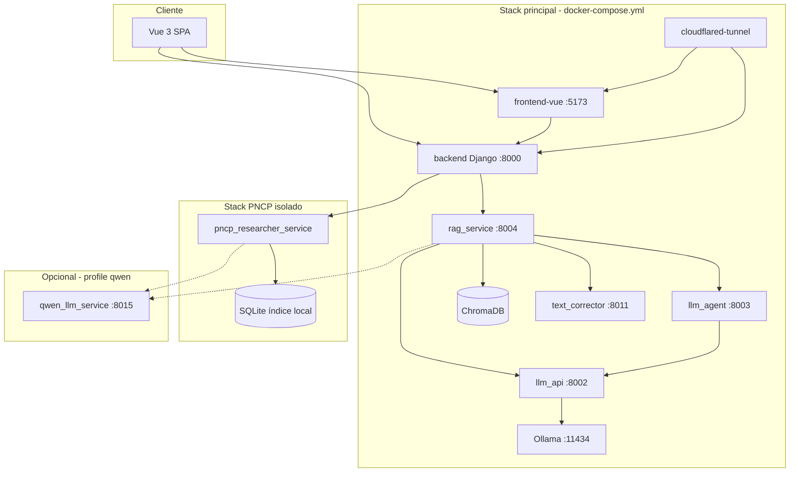
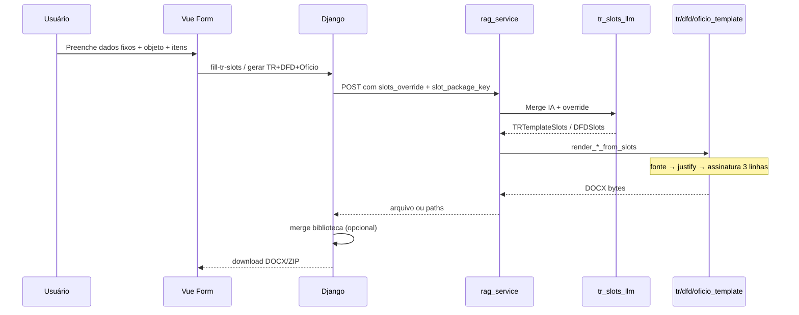
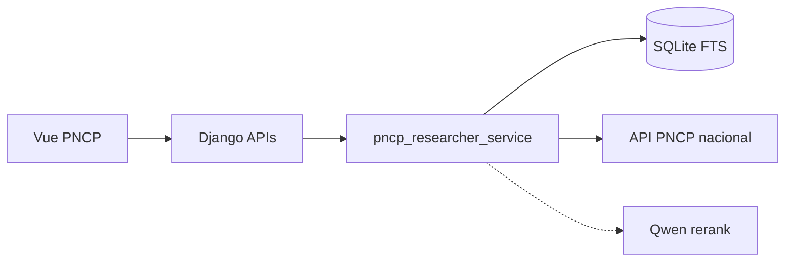

# DocMaster Core — Visão completa do sistema

Documento de referência **transversal**: reúne funcionalidades, fatores técnicos, fluxos e ligações para toda a documentação em `docs/`. Use como mapa mental antes de mergulhar em um módulo específico.

**Público:** desenvolvedores, operação, revisão técnica e assistentes de IA.  
**Última atualização:** junho/2026.

---

## Índice

1. [O que é o DocMaster](#1-o-que-é-o-docmaster)
2. [Arquitetura geral](#2-arquitetura-geral)
3. [Stack e serviços](#3-stack-e-serviços)
4. [Módulos funcionais](#4-módulos-funcionais)
5. [Geração TR / DFD / Ofício (Lei 14.133)](#5-geração-tr--dfd--ofício-lei-14133)
6. [Pipeline RAG e LLM](#6-pipeline-rag-e-llm)
7. [Biblioteca de modelos e merge DOCX](#7-biblioteca-de-modelos-e-merge-docx)
8. [Análise de conformidade (Lei 14.133)](#8-análise-de-conformidade-lei-14133)
9. [Pesquisador PNCP](#9-pesquisador-pncp)
10. [Correção textual e serviços auxiliares](#10-correção-textual-e-serviços-auxiliares)
11. [Autenticação, multi-tenant e API](#11-autenticação-multi-tenant-e-api)
12. [Observabilidade e métricas](#12-observabilidade-e-métricas)
13. [Deploy, produção e fatores operacionais](#13-deploy-produção-e-fatores-operacionais)
14. [Configuração e variáveis de ambiente](#14-configuração-e-variáveis-de-ambiente)
15. [Ativos tecnológicos reutilizáveis](#15-ativos-tecnológicos-reutilizáveis)
16. [Correções recentes (jun/2026)](#16-correções-recentes-jun2026)
17. [Mapa completo da documentação](#17-mapa-completo-da-documentação)

---

## 1. O que é o DocMaster

O **DocMaster Core** é um sistema corporativo para **geração, leitura, interpretação, edição e adequação de documentos de licitação pública brasileira**, com foco na **Lei 14.133/2021**.

| Capacidade | Descrição |
|------------|-----------|
| **Gerar documentos** | TR, DFD, Ofício, ETP e variantes por pacote de templates (`lei_14133`) |
| **Preencher modelos DOCX** | Slots tipados + placeholders padronizados + cláusulas geradas por IA |
| **Pesquisar preços** | Módulo PNCP: cotações, busca inteligente/manual, relatório PDF |
| **Analisar conformidade** | Documento enviado vs. Lei 14.133 via RAG + LLM |
| **Biblioteca institucional** | Templates DOCX por prefeitura (capa, papel timbrado, merge) |

**Princípios do produto** (detalhes em [projeto/CONTEXTO_PROJETO_DOCMASTER_IA.md](./projeto/CONTEXTO_PROJETO_DOCMASTER_IA.md)):

- Ferramenta **assistiva** — não promete validade jurídica automática.
- **Rastreabilidade**: logs de LLM, auditoria de inferência, métricas de geração.
- **Separação de responsabilidades**: Django (negócio) ≠ orquestração LLM ≠ inferência.
- Documentos licitatórios tratados como **dados sensíveis**.

---

## 2. Arquitetura geral



### Camadas lógicas

| Camada | Componentes | Responsabilidade |
|--------|-------------|------------------|
| **Apresentação** | `frontend-vue/` | Formulários de dispensa/inexigibilidade, gerador, PNCP, biblioteca |
| **API / negócio** | `backend/` (Django) | Auth, multi-tenant, persistência, proxy LLM/PNCP, merge biblioteca |
| **Orquestração IA** | `rag_service/`, `llm_agent/`, `llm_api/` | RAG, estrutura, cláusulas, slots, render DOCX |
| **Inferência** | Ollama local, Qwen (opcional) | Modelos de linguagem |
| **Conhecimento** | ChromaDB, índice PNCP SQLite | Embeddings Lei 14.133 / guias / itens PNCP |
| **Operação** | Prometheus, Grafana, scripts `deploy/` | Métricas, boot, ingest 24/7 |

Documentação de integração: [integracao/INTEGRACAO_DJANGO_LLM.md](./integracao/INTEGRACAO_DJANGO_LLM.md) · [integracao/API_FRONTEND_BACKEND.md](./integracao/API_FRONTEND_BACKEND.md) · [integracao/DOCKER.md](./integracao/DOCKER.md)

---

## 3. Stack e serviços

### 3.1 Serviços do `docker-compose.yml` (principal)

| Serviço | Porta | Função | Documentação |
|---------|-------|--------|--------------|
| **backend** | 8000 | Django REST, auth, documentos, proxy | [servicos/DOC_BACKEND.md](./servicos/DOC_BACKEND.md) |
| **frontend-vue** | 5173 (dev) / estático | SPA Vue 3 + Vite | — |
| **rag_service** | 8004 | RAG, geração, análise, templates TR/DFD | [servicos/DOC_RAG_SERVICE.md](./servicos/DOC_RAG_SERVICE.md) |
| **llm_agent** | 8003 | Estrutura de documento, cláusulas | [servicos/DOC_LLM_AGENT.md](./servicos/DOC_LLM_AGENT.md) |
| **llm_api** | 8002 | Orquestração Ollama, retry, auditoria | [servicos/DOC_LLM_API.md](./servicos/DOC_LLM_API.md) |
| **ollama** | 11434 | Inferência local | — |
| **qwen_llm_service** | 8015 | Qwen (profile `qwen`) — ETP, cláusulas, PNCP IA | [integracao/QWEN-INTEGRACAO-DOCMASTER.md](./integracao/QWEN-INTEGRACAO-DOCMASTER.md) |
| **text_corrector_service** | 8011 | LanguageTool / revisão semântica | `text_corrector_service/README.md` |
| **chromadb** | interno | Vector store | — |
| **prometheus** | 9090 | Métricas | [deploy/OBSERVABILIDADE-VPS.md](./deploy/OBSERVABILIDADE-VPS.md) |
| **grafana** | 3000 | Dashboards | idem |
| **cloudflared-tunnel** | — | Exposição pública | [deploy/STACK-E-CLOUDFLARE-502.md](./deploy/STACK-E-CLOUDFLARE-502.md) |

### 3.2 Stack PNCP isolado

| Serviço | Compose | Função |
|---------|---------|--------|
| **pncp_researcher_service** | `docker-compose.pncp.yml` | Índice SQLite, ingest 24/7, busca API |

**Regra:** `docker compose up` do stack principal **não** deve recriar o PNCP (projeto Compose separado: `docmaster-pncp`).

→ [pncp/00-INDICE.md](./pncp/00-INDICE.md) · [deploy/PNCP-RESEARCHER-24-7.md](./deploy/PNCP-RESEARCHER-24-7.md)

### 3.3 Repositório — diretórios principais

| Diretório | Papel |
|-----------|-------|
| `backend/` | Django `mdlicitatech`, apps, models, APIs |
| `frontend-vue/` | UI gerador, dispensa 75 II, PNCP, biblioteca |
| `rag_service/` | FastAPI — núcleo de geração e RAG |
| `llm_api/` | Gateway LLM com auditoria |
| `llm_agent/` | Agente de estrutura e cláusulas |
| `pncp_researcher_service/` | API PNCP + worker ingest |
| `template_packages/` | Modelos DOCX por pacote (`lei_14133/...`) |
| `text_corrector_service/` | Correção gramatical |
| `config/` | Prometheus, Grafana provisioning |
| `scripts/` | Boot, ingest PNCP, observabilidade |
| `docs/` | Esta documentação |

---

## 4. Módulos funcionais

Visão por **capacidade de negócio**, não só por serviço.

### 4.1 Gerador de documentos (UI principal)

| Aspecto | Detalhe |
|---------|---------|
| **Rota Django** | `<prefeitura>/gerador_de_documentos/` |
| **Frontend** | `DocumentGenerator.vue` + formulários por fluxo (dispensa, inexigibilidade, ETP) |
| **Modos** | Geração via LLM/RAG; preenchimento de template da biblioteca; pacotes TR+DFD+Ofício |
| **Saída** | DOCX (PDF em alguns fluxos) |

Fluxos especializados em `frontend-vue/src/components/dispensa-art-75-ii/`:

- **Normal** — objeto detalhado + cláusulas IA + geração TR/DFD/Ofício
- **Rápida** — menos campos, mesmo pipeline de slots
- **Dados fixos** — drawer com setor, cidade, assinante, etc. (preset por usuário)

### 4.2 Biblioteca de documentos

| Aspecto | Detalhe |
|---------|---------|
| **Rota** | `<prefeitura>/biblioteca_documentos/` |
| **API** | `api/documentos_modelos/*` — upload, listagem, geração por values |
| **Merge** | Após RAG, Django pode combinar corpo gerado com capa institucional (`merge_docx_with_template_body`) |

→ [servicos/DOC_BACKEND.md](./servicos/DOC_BACKEND.md) § APIs de templates

### 4.3 Área do usuário e dashboard

- Documentos gerados, histórico, perfil
- Rotas tenant: `area_do_usuario/`, `dashboard/`
- Auth: sessão Django + APIs `api/auth/*`, `api/me/*`

→ [integracao/AUTENTICACAO_DJANGO.md](./integracao/AUTENTICACAO_DJANGO.md)

### 4.4 Pesquisador PNCP

- Cotações de preço por usuário
- Busca inteligente (IA + índice local) e busca manual
- Importação planilha Excel/CSV
- Relatório PDF institucional + anexo fornecedor

→ [pncp/PESQUISADOR_PNCP_FUNCIONAMENTO_ATUAL.md](./pncp/PESQUISADOR_PNCP_FUNCIONAMENTO_ATUAL.md)  
→ [integracao/IMPORTACAO_PLANILHA_COTACAO_MANUAL.md](./integracao/IMPORTACAO_PLANILHA_COTACAO_MANUAL.md)

### 4.5 Análise de documentos

- Upload DOCX/PDF → conformidade Lei 14.133
- Endpoint RAG: `POST /api/rag/analyze-document`
- Coleção Chroma filtrada por `document_type` (lei, guia, tr, etp, dfd)

→ [servicos/MODULO_ANALISE_DOCUMENTOS.md](./servicos/MODULO_ANALISE_DOCUMENTOS.md)

### 4.6 Ingestão de conhecimento (RAG)

- Manuais, ETP, TR, DFD modelo → ChromaDB
- Endpoints: `ingest-manual`, `smart-ingest/file`, `smart-ingest/folder`
- Alimenta **gerador** (exemplos por tipo) e **analisador** (lei + guias)

→ [geracao-documentos/INGESTAO_GUIA_ETP_DFD_TR.md](./geracao-documentos/INGESTAO_GUIA_ETP_DFD_TR.md)

---

## 5. Geração TR / DFD / Ofício (Lei 14.133)

Núcleo do produto para **Dispensa Art. 75** e pacotes relacionados em `template_packages/lei_14133/`.

### 5.1 Pacotes por rota (`slot_package_key`)

| Rota / fluxo | Pacote |
|--------------|--------|
| Dispensa 75 I — manutenção veículos | `dispensa_75_i_manutencao_veiculos` |
| Dispensa 75 I — obras engenharia | `dispensa_75_i_obras_engenharia` |
| Dispensa 75 II — compras | `dispensa_75_ii_compras` |
| Dispensa 75 II — serviços | `dispensa_75_ii_servicos` |
| Dispensa 75 II — compras + serviços | `dispensa_75_ii_compras_servicos_inclusos` |
| Inexigibilidade 74 I — veículos | `inexigibilidade_74_i_manutencao_de_veiculos` |
| Inexigibilidade 74 I — fornecedor exclusivo | `inexigibilidade_74_i_fornecedor_exclusivo` |
| ETP livre | `etp_livre` |
| Fallback | `tr_dfd_generico` |

Cada pacote contém `TR_modelo_base.docx`, `DFD_modelo_base.docx`, `OFICIO_modelo_base.docx` (quando aplicável).

→ [geracao-documentos/01-slots-tr-dfd-oficio.md](./geracao-documentos/01-slots-tr-dfd-oficio.md)  
→ [geracao-documentos/TR_MODELO_BASE_ANALISE.md](./geracao-documentos/TR_MODELO_BASE_ANALISE.md)  
→ `template_packages/lei_14133/README.md`

### 5.2 Fluxo completo (Dispensa 75 II)



### 5.3 Slots e placeholders

- **Convenção:** `(TR_OBJETO)`, `(DFD_SETOR_REQUISITANTE)`, `(SOL_OFICIO_RESPONSAVEL_NOME)` — prefixo por documento, caixa alta, parênteses no DOCX.
- **Frontend** monta `slots_override` (JSON chave-valor).
- **RAG** faz merge com saída da IA em `tr_slots_llm.py`.
- **Templates** aplicam substituição literal preservando formatação por run.

### 5.4 Tipografia e assinatura (pós-processamento)

Ordem no render:

1. Substituição de placeholders e inserção de tabelas/cláusulas
2. `apply_standard_body_font_to_document()`
3. `apply_default_justify_to_document()` — justifica sem destruir alinhamentos explícitos
4. `ensure_signature_nome_blank_lines()` — **3 linhas vazias** entre cidade/data e nome

→ [geracao-documentos/03-docx-tipografia-e-assinatura.md](./geracao-documentos/03-docx-tipografia-e-assinatura.md)

### 5.5 DFD — setor requisitante

- Campo canônico: **Dados fixos → Setor requisitante** (`fixoSetor`)
- **Não** usar «Qual setor/secretaria será atendido?» (`objetoSetor`) no DFD
- Sanitização defensiva no RAG: `dfd_slot_sanitize.py`

→ [geracao-documentos/02-dfd-setor-requisitante.md](./geracao-documentos/02-dfd-setor-requisitante.md)

### 5.6 Código-fonte principal

| Arquivo | Função |
|---------|--------|
| `rag_service/app/tr_template.py` | Render TR + tabela itens |
| `rag_service/app/dfd_template.py` | Render DFD |
| `rag_service/app/oficio_template.py` | Render Ofício |
| `rag_service/app/tr_slots_llm.py` | Slots IA + merge override |
| `rag_service/app/docx_typography.py` | Fonte, justify, assinatura |
| `rag_service/app/dfd_slot_sanitize.py` | Sanitize setor DFD |
| `frontend-vue/.../dispensaArt75iiShared.js` | Helpers compartilhados |

---

## 6. Pipeline RAG e LLM

### 6.1 Geração genérica (prompt livre)

Fluxo clássico documentado em [README.md](./README.md):

1. `POST api/documentos/gerar-via-llm` (Django)
2. `POST /api/rag/generate-document` (RAG)
3. LLM Agent → `structure-from-prompt`
4. Por seção: retrieval Chroma + `POST /api/llm/generate`
5. `json_to_docx` → DOCX/PDF

### 6.2 Geração TR/DFD por slots (fluxo atual Dispensa)

1. Frontend envia `slots_override`, `slot_package_key`, prompt de cláusulas
2. `tr_slots_llm.py` preenche objeto, justificativa, itens, datas, assinatura
3. Templates fixos aplicam slots — **sem** reestruturar o DOCX inteiro via IA
4. Cláusulas longas podem vir de LLM (Qwen ou Ollama conforme env)

### 6.3 Modelos LLM e roteamento

| Uso | Variável típica | Provider |
|-----|-----------------|----------|
| Orquestração geral | `LLM_ORCHESTRATION_BASE_URL` | `llm_api` → Ollama |
| ETP | `LLM_ETP_GENERATION_BASE_URL` | Qwen (opcional) |
| Cláusulas dispensa/inexig | `LLM_CLAUSULAS_GENERATION_BASE_URL` | Qwen ou Ollama |
| PNCP busca inteligente | `PNCP_IA_BASE_URL` | Qwen |

→ [servicos/DOC_LLM_API.md](./servicos/DOC_LLM_API.md) · [servicos/DOC_LLM_AGENT.md](./servicos/DOC_LLM_AGENT.md)  
→ [servicos/ANALISE_DETALHADA_RAG_SERVICE.md](./servicos/ANALISE_DETALHADA_RAG_SERVICE.md)

### 6.4 Auditoria LLM

- Logs JSONL em `llm_audit/` (volume Docker)
- Prompt, resposta bruta, tempo, contexto da requisição
- Métricas Django: `docmaster_llm_tokens_total`, `docmaster_llm_invocations_total`

---

## 7. Biblioteca de modelos e merge DOCX

Dois caminhos de geração coexistem:

| Caminho | Entrada | Motor |
|---------|---------|-------|
| **Biblioteca** | `template_id` + `values` (campos do schema) | Django render index/tokens |
| **IA + pacote Lei 14.133** | `slots_override` + `slot_package_key` | `rag_service` templates |

Quando o usuário escolhe template da biblioteca **e** gera TR/DFD pelo pacote:

- RAG produz o **corpo** normativo
- Django aplica `merge_docx_with_template_body()` para inserir em papel timbrado institucional

**Fator operacional:** alterações em `template_packages/` exigem **rebuild** da imagem `rag_service` — ver [geracao-documentos/04-deploy-templates-docx.md](./geracao-documentos/04-deploy-templates-docx.md).

---

## 8. Análise de conformidade (Lei 14.133)

| Etapa | Tecnologia |
|-------|------------|
| Extração texto | pypdf / docx2txt |
| Chunking | Seções ou blocos ~2,8k chars |
| Retrieval | Chroma — `document_type=lei` + `guia` |
| Análise | LLM por chunk |
| Agregação | Deduplica acertos/erros |

**Isolamento:** gerador busca `termo_referencia` / `etp` / `dfd`; analisador busca `lei` + `guia` — mesma coleção, filtros diferentes.

→ [servicos/MODULO_ANALISE_DOCUMENTOS.md](./servicos/MODULO_ANALISE_DOCUMENTOS.md)  
→ [geracao-documentos/INGESTAO_GUIA_ETP_DFD_TR.md](./geracao-documentos/INGESTAO_GUIA_ETP_DFD_TR.md)

---

## 9. Pesquisador PNCP

### 9.1 Componentes



### 9.2 Funcionalidades

| Funcionalidade | Onde |
|----------------|------|
| CRUD cotações | `backend/app/pncp_cotacao_api.py` |
| Itens, fórmula Art. 5º | `pncp_relatorio_itens.py` |
| Relatório PDF | `pncp_relatorio_pdf.py` |
| Busca manual / inteligente | `pncp_researcher_service` + views Vue |
| Ingest 24/7 | Worker + planner + fila (stack isolado) |
| Índice local FTS5 | SQLite em volume Docker persistente |

### 9.3 Documentação PNCP (por tema)

| Tema | Documento |
|------|-----------|
| Índice geral | [pncp/00-INDICE.md](./pncp/00-INDICE.md) |
| Estado declarativo | [pncp/PNCP-DECLARATIVO.md](./pncp/PNCP-DECLARATIVO.md) |
| Funcionamento atual | [pncp/PESQUISADOR_PNCP_FUNCIONAMENTO_ATUAL.md](./pncp/PESQUISADOR_PNCP_FUNCIONAMENTO_ATUAL.md) |
| Busca inteligente + Qwen | [pncp/PNCP-BUSCA-INTELIGENTE-QUALIDADE.md](./pncp/PNCP-BUSCA-INTELIGENTE-QUALIDADE.md) |
| Fornecedor / relatório | [pncp/PNCP-FORNECEDOR-RELATORIO-REGRAS.md](./pncp/PNCP-FORNECEDOR-RELATORIO-REGRAS.md) |
| Planejamento técnico | [pncp/planejamento/00-INDICE.md](./pncp/planejamento/00-INDICE.md) |
| Deploy ingest 24/7 | [deploy/PNCP-INGESTAO-INDEX-24-7.md](./deploy/PNCP-INGESTAO-INDEX-24-7.md) |
| Comandos operação | [deploy/PNCP-COMANDOS-OPERACAO.txt](./deploy/PNCP-COMANDOS-OPERACAO.txt) |
| Paridade lote vs item | [pncp/PNCP-IMPLEMENTACAO-PARIDADE-LOTE.md](./pncp/PNCP-IMPLEMENTACAO-PARIDADE-LOTE.md) |
| Cobertura fornecedor (roadmap) | [pncp/PLANO-MODULO-COBERTURA-FORNECEDOR-PNCP.md](./pncp/PLANO-MODULO-COBERTURA-FORNECEDOR-PNCP.md) |
| Fontes múltiplas de preço | [pncp/PLANO-FONTES-PRECOS-MULTIPLAS-PLATAFORMAS.md](./pncp/PLANO-FONTES-PRECOS-MULTIPLAS-PLATAFORMAS.md) |

### 9.4 Fatores críticos PNCP

- **Nunca** `docker compose -f docker-compose.pncp.yml down -v` (apaga SQLite)
- Volume: `docmaster-pncp_pncp_researcher_data`
- Um único loop de ingest (systemd ou script idempotente)
- Stack PNCP separado evita recreate acidental no `up` do backend

---

## 10. Correção textual e serviços auxiliares

| Serviço | Porta | Uso |
|---------|-------|-----|
| **text_corrector_service** | 8011 | Pós-processamento gramatical (LanguageTool); evolução semântica documentada em `SEMANTIC_REVIEW_EVOLUTION.md` |

Chamado pelo RAG em fluxos que exigem revisão de texto gerado antes do DOCX final.

---

## 11. Autenticação, multi-tenant e API

### 11.1 Multi-tenant por prefeitura

- URLs: `/<prefeitura_slug>/...`
- Login, dashboard, gerador e biblioteca isolados por tenant
- Contexto do usuário (nome, secretaria, órgão) injetado no `context` enviado ao RAG

### 11.2 Autenticação

- Sessão Django + APIs JSON (`api/auth/login`, `api/me`)
- Rotas PNCP e gerador exigem login (`router.beforeEach` no Vue)
- Proxy LLM: `api/llm/<path>` — requer sessão

→ [integracao/AUTENTICACAO_DJANGO.md](./integracao/AUTENTICACAO_DJANGO.md)  
→ [integracao/API_FRONTEND_BACKEND.md](./integracao/API_FRONTEND_BACKEND.md)

### 11.3 APIs principais (resumo)

| Endpoint | Função |
|----------|--------|
| `POST api/documentos/gerar-via-llm` | Geração via RAG |
| `POST api/documentos_modelos/gerar` | Template biblioteca + values |
| `POST api/documentos_modelos/enviar` | Upload template |
| `POST /api/pncp/cotacoes/...` | Módulo PNCP |
| `GET /metrics` | Prometheus (backend) |

Detalhes completos: [servicos/DOC_BACKEND.md](./servicos/DOC_BACKEND.md)

---

## 12. Observabilidade e métricas

| Ferramenta | Função |
|------------|--------|
| **django-prometheus** | Métricas HTTP, negócio, LLM |
| **Prometheus** | Scrape backend, node_exporter |
| **Grafana** | Dashboard «DocMaster — Backend Django» |

Métricas de negócio exemplares:

- `docmaster_document_operations_total` (gerações TR/DFD por pacote)
- `docmaster_llm_tokens_total` / `docmaster_llm_invocations_total`
- Logins, duração de operações, erros por fluxo

→ [deploy/OBSERVABILIDADE-VPS.md](./deploy/OBSERVABILIDADE-VPS.md)  
→ [deploy/ENTREGA-MODULOS.md](./deploy/ENTREGA-MODULOS.md) (checklist Módulos 1 e 2)  
→ `config/prometheus/README.md`

---

## 13. Deploy, produção e fatores operacionais

### 13.1 Ambiente de produção típico

- VPS / desktop Windows com **WSL2**
- Docker Compose em `~/` (ao lado de `~/docmaster-core/`)
- **Cloudflare Tunnel** → frontend + backend (sem nginx obrigatório)
- Dois stacks: principal + PNCP

→ [deploy/README.md](./deploy/README.md)

### 13.2 Fatores que afetam o sistema

| Fator | Impacto | Mitigação |
|-------|---------|-----------|
| **Cloudflare timeout ~100s** | Gerações longas podem falhar na borda | Timeouts internos maiores; nginx example 900s; operações assíncronas onde possível |
| **WSL idle** | Stack «dorme» com PC ligado | `vmIdleTimeout=-1` em `.wslconfig` |
| **Rebuild sem build** | Código/templates antigos na imagem | Sempre `docker compose build` antes de `up --force-recreate` |
| **Volume PNCP** | Perda de índice se `down -v` | Backups, scripts `find-pncp-db-volumes.sh` |
| **GPU Ollama** | Performance inferência | `deploy.resources` NVIDIA no compose |
| **Reboot** | Serviços parados | `ensure-docmaster-stack.sh`, systemd boot |

### 13.3 Deploy de alterações TR/DFD

```bash
cd ~/docmaster-core && git pull
cd ~
docker compose build rag_service frontend-vue   # conforme o que mudou
docker compose up -d --force-recreate rag_service frontend-vue
```

→ [geracao-documentos/04-deploy-templates-docx.md](./geracao-documentos/04-deploy-templates-docx.md)  
→ [deploy/CHANGELOG-OPERACOES-2026-06.md](./deploy/CHANGELOG-OPERACOES-2026-06.md)

### 13.4 Scripts operacionais

| Script | Função |
|--------|--------|
| `scripts/ensure-docmaster-stack.sh` | Sobe app + túnel + observabilidade |
| `scripts/ensure-pncp-researcher.sh` | Mantém container PNCP |
| `scripts/run-pncp-index-ingest-loop.sh` | Loop ingestão índice |
| `scripts/install-docmaster-boot-service.sh` | Boot systemd |

→ [deploy/PNCP-SCRIPTS-REFERENCIA.md](./deploy/PNCP-SCRIPTS-REFERENCIA.md)

---

## 14. Configuração e variáveis de ambiente

Variáveis críticas (não exaustivo):

| Variável | Serviço | Efeito |
|----------|---------|--------|
| `RAG_SERVICE_URL` | Django | URL do rag_service |
| `LLM_API_BASE_URL` | Django, RAG | Orquestração Ollama |
| `LLM_CLAUSULAS_*` | RAG, Django | Provider cláusulas |
| `LLM_ETP_GENERATION_BASE_URL` | RAG | ETP via Qwen |
| `OLLAMA_MODEL` | llm_api | Modelo padrão |
| `RAG_HTTP_TIMEOUT_TR_DFD_MAX` | Django | Timeout geração longa |
| `PNCP_IA_BASE_URL` | pncp_researcher | Rerank/busca IA |
| `CLOUDFLARE_TUNNEL_TOKEN` | cloudflared | Túnel público |

→ [servicos/DOC_CONFIG_AMBIENTE.md](./servicos/DOC_CONFIG_AMBIENTE.md)  
→ [pncp/planejamento/07-CONFIGURACAO-DEPLOY-OPS.md](./pncp/planejamento/07-CONFIGURACAO-DEPLOY-OPS.md)

---

## 15. Ativos tecnológicos reutilizáveis

Componentes com potencial de extração como produto ou biblioteca:

| Ativo | Descrição | Doc |
|-------|-----------|-----|
| TR/DFD/Ofício Template Engine | Render DOCX por slots | [projeto/ATIVOS_TECNOLOGICOS.md](./projeto/ATIVOS_TECNOLOGICOS.md) §1 |
| Engine de Slots Lei 14.133 | `tr_slots_llm` + IA | idem §2 |
| RAG Document Engine | Geração completa ETP/TR/DFD | idem §3 |
| Compliance Checker | Análise Lei 14.133 | idem §4 |
| PNCP Index + Search | Índice local + API | idem + pasta `pncp/` |

---

## 16. Correções recentes (jun/2026)

Alterações validadas em produção na geração Dispensa 75 II:

| # | Problema | Status | Documentação |
|---|----------|--------|--------------|
| 1 | `DFD_SETOR_REQUISITANTE` com valor do prompt IA | ✅ Corrigido | [02-dfd-setor-requisitante.md](./geracao-documentos/02-dfd-setor-requisitante.md) |
| 2 | Justificativa alinhada à esquerda indevidamente | ✅ Corrigido | [03-docx-tipografia-e-assinatura.md](./geracao-documentos/03-docx-tipografia-e-assinatura.md) |
| 3 | 5 linhas vazias antes do nome (data digital) | ✅ Corrigido | idem + [CHANGELOG-2026-06.md](./geracao-documentos/CHANGELOG-2026-06.md) |
| 4 | Deploy sem rebuild mantinha templates antigos | ✅ Documentado | [04-deploy-templates-docx.md](./geracao-documentos/04-deploy-templates-docx.md) |

Changelog consolidado: [geracao-documentos/CHANGELOG-2026-06.md](./geracao-documentos/CHANGELOG-2026-06.md)

---

## 17. Mapa completo da documentação

### Raiz `docs/`

| Arquivo | Conteúdo |
|---------|----------|
| [README.md](./README.md) | Índice resumido |
| [README_DOCUMENTACAO.md](./README_DOCUMENTACAO.md) | Redirect + mapa caminhos antigos |
| **SISTEMA-DOCMASTER-VISAO-COMPLETA.md** | **Este documento** |

### `geracao-documentos/`

| Arquivo | Conteúdo |
|---------|----------|
| [00-INDICE.md](./geracao-documentos/00-INDICE.md) | Índice TR/DFD/Ofício |
| [01-slots-tr-dfd-oficio.md](./geracao-documentos/01-slots-tr-dfd-oficio.md) | Slots ↔ placeholders |
| [02-dfd-setor-requisitante.md](./geracao-documentos/02-dfd-setor-requisitante.md) | Setor requisitante |
| [03-docx-tipografia-e-assinatura.md](./geracao-documentos/03-docx-tipografia-e-assinatura.md) | Tipografia DOCX |
| [04-deploy-templates-docx.md](./geracao-documentos/04-deploy-templates-docx.md) | Deploy templates |
| [CHANGELOG-2026-06.md](./geracao-documentos/CHANGELOG-2026-06.md) | Changelog jun/2026 |
| [TR_MODELO_BASE_ANALISE.md](./geracao-documentos/TR_MODELO_BASE_ANALISE.md) | Análise modelo TR |
| [INGESTAO_GUIA_ETP_DFD_TR.md](./geracao-documentos/INGESTAO_GUIA_ETP_DFD_TR.md) | Ingestão RAG |

### `servicos/`

| Arquivo | Conteúdo |
|---------|----------|
| [DOC_BACKEND.md](./servicos/DOC_BACKEND.md) | Django |
| [DOC_RAG_SERVICE.md](./servicos/DOC_RAG_SERVICE.md) | RAG Service |
| [DOC_LLM_API.md](./servicos/DOC_LLM_API.md) | LLM API |
| [DOC_LLM_AGENT.md](./servicos/DOC_LLM_AGENT.md) | LLM Agent |
| [DOC_CONFIG_AMBIENTE.md](./servicos/DOC_CONFIG_AMBIENTE.md) | Env vars |
| [ANALISE_DETALHADA_RAG_SERVICE.md](./servicos/ANALISE_DETALHADA_RAG_SERVICE.md) | Análise RAG |
| [MODULO_ANALISE_DOCUMENTOS.md](./servicos/MODULO_ANALISE_DOCUMENTOS.md) | Compliance |

### `integracao/`

| Arquivo | Conteúdo |
|---------|----------|
| [INTEGRACAO_DJANGO_LLM.md](./integracao/INTEGRACAO_DJANGO_LLM.md) | Django ↔ LLM/RAG |
| [API_FRONTEND_BACKEND.md](./integracao/API_FRONTEND_BACKEND.md) | Contratos API |
| [AUTENTICACAO_DJANGO.md](./integracao/AUTENTICACAO_DJANGO.md) | Auth |
| [DOCKER.md](./integracao/DOCKER.md) | Docker local |
| [QWEN-INTEGRACAO-DOCMASTER.md](./integracao/QWEN-INTEGRACAO-DOCMASTER.md) | Qwen |
| [IMPORTACAO_PLANILHA_COTACAO_MANUAL.md](./integracao/IMPORTACAO_PLANILHA_COTACAO_MANUAL.md) | Planilha PNCP |

### `projeto/`

| Arquivo | Conteúdo |
|---------|----------|
| [CONTEXTO_PROJETO_DOCMASTER_IA.md](./projeto/CONTEXTO_PROJETO_DOCMASTER_IA.md) | Missão e arquitetura IA |
| [ATIVOS_TECNOLOGICOS.md](./projeto/ATIVOS_TECNOLOGICOS.md) | Ativos extraíveis |
| [ERROS_ATUAIS_DEBUG_2026-04-08.md](./projeto/ERROS_ATUAIS_DEBUG_2026-04-08.md) | Debug histórico |

### `pncp/` e `deploy/`

- PNCP: [pncp/00-INDICE.md](./pncp/00-INDICE.md) + 20+ documentos especializados
- Deploy: [deploy/README.md](./deploy/README.md) + 15 guias operacionais

### Documentação fora de `docs/`

| Caminho | Conteúdo |
|---------|----------|
| `template_packages/lei_14133/README.md` | Pacotes de templates |
| `rag_service/README.md` | RAG service |
| `pncp_researcher_service/RESUMAO_PNCP_RESEARCHER_SERVICE.md` | Resumo PNCP |
| `text_corrector_service/README.md` | Corretor textual |
| `CLAUDE.md` (raiz portfolio) | Comandos e visão multi-projeto |

---

## Apêndice A — Testes relevantes

```bash
# Tipografia e assinatura
cd rag_service && pytest tests/test_docx_typography.py tests/test_signature_nome_spacing.py -v

# Sanitização DFD setor
pytest tests/test_dfd_slot_sanitize.py -v

# PNCP (no serviço)
cd pncp_researcher_service && pytest
```

---

## Apêndice B — Glossário rápido

| Termo | Significado |
|-------|-------------|
| **Slot** | Campo tipado no JSON (`objeto`, `justificativa`, `dfd_setor_requisitante`) |
| **Placeholder** | Texto `(TR_OBJETO)` no DOCX substituído pelo slot |
| **slot_package_key** | Pasta em `template_packages/lei_14133/<pacote>/` |
| **slots_override** | JSON do frontend sobrescrevendo slots da IA |
| **Dados fixos** | Preset do usuário (cidade, setor, assinante) no drawer |
| **RAG** | Retrieval-Augmented Generation — busca + geração |
| **Pacote** | Conjunto TR + DFD + Ofício para um fluxo legal específico |

---

*Documento mantido junto com [README.md](./README.md). Para correções pontuais de jun/2026, priorize [geracao-documentos/CHANGELOG-2026-06.md](./geracao-documentos/CHANGELOG-2026-06.md).*
