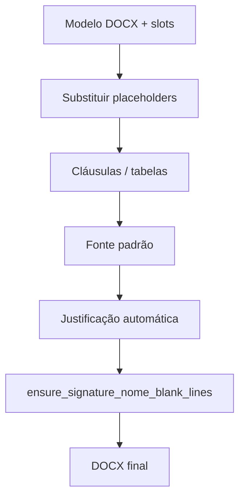

# Tipografia DOCX e espaçamento da assinatura

Módulo central: `rag_service/app/docx_typography.py`

Aplicado ao final da geração em `tr_template.py`, `dfd_template.py` e `oficio_template.py`.

---

## 1. Justificação automática

### Função

`apply_default_justify_to_document(doc)`

### Comportamento

| Situação | Ação |
|----------|------|
| Parágrafo sem alinhamento explícito (`alignment is None`) | Define **justificado** |
| Parágrafo já justificado / centro / direita no modelo | **Preserva** |
| Lista romana curta (`I – …`, `II – …`) | Esquerda, se ainda sem alinhamento |
| Bloco §15.1 (instrumento de contrato) | Esquerda, inclusive em texto longo |
| Estilos `Heading N` | Ignorados por padrão |

### Heurística `paragraph_should_remain_left_aligned`

Identifica parágrafos que não devem ser justificados automaticamente:

- Itens romanos curtos no início da linha
- Bloco `15.1. O instrumento de contrato poderá ser substituído…`
- Listas romanas multi-linha compactas (ex.: manutenção §2.1 veículos)

**Não** trata justificativas longas que mencionam «manutenção preventiva/corretiva» no meio do texto como lista — correção de jun/2026.

### Outras funções de tipografia

| Função | Uso |
|--------|-----|
| `apply_standard_body_font_to_document` | Fonte padrão do corpo (Calibri 11pt ou conforme modelo) |
| `clamp_docx_paragraph_indents` | Zera indentação negativa que transborda margens |
| `apply_dfd_inclusive_role_labels` | «Gestor de Contratos» → «Gestor(a) de Contratos» |

### Testes

`rag_service/tests/test_docx_typography.py`

---

## 2. Espaçamento da assinatura (3 linhas)

### Regra de negócio

Entre a linha **cidade/data** e o parágrafo do **nome do assinante** devem existir **exatamente 3 parágrafos vazios**.

Marcadores reconhecidos:

| Documento | Placeholder do nome |
|-----------|---------------------|
| TR | `(TR_NOME_ASSINANTE_TERMO)`, `(NOME DO ASSINANTE DO TERMO)` |
| DFD | `(DFD_NOME_ASSINATURA)`, `(NOME ASSINATURA DFD)` |
| Ofício | `(SOL_OFICIO_RESPONSAVEL_NOME)` |

### Função principal

`ensure_signature_nome_blank_lines(doc, blank_lines=3)`

### Algoritmo

```
1. Encontrar parágrafo do nome
   - Por marcador ainda presente no DOCX, OU
   - Estrutural: após linha cidade/data → pular vazios → primeiro texto

2. Âncora = parágrafo com texto imediatamente antes do bloco de vazios que precede o nome
   (em geral: «São Paulo - SP, 22 de junho de 2026»)

3. _remove_gap_paragraphs_between(âncora, nome) — remove TODOS os vazios intermediários

4. Inserir blank_lines parágrafos vazios antes do nome

5. _set_signature_gap_paragraph_spacing — space_before/after = 0 em cada vazio
```

### Detecção da linha cidade/data

`_paragraph_looks_like_cidade_data_line()` aceita:

- Marcadores `(TR_CIDADE)`, `(DFD_DATA)`, etc.
- Texto com vírgula + ano de 4 dígitos (`19xx` / `20xx`)
- **«datado e assinado digitalmente»** (correção jun/2026)
- Padrão `Cidade - UF, …` (regex `\s-\s*[A-Z]{2}\s*,`)

### Bug corrigido (5 linhas)

| Cenário | Antes | Depois |
|---------|-------|--------|
| Data com ano (`22 de junho de 2026`) | Às vezes 5 (modelo tinha 5 vazios) | 3 |
| Data digital | **5** — função não rodava | **3** |

Com data digital, a detecção antiga exigia `\b(19|20)\d{2}\b`. Sem ano, `ensure_signature_nome_blank_lines` retornava cedo e o template mantinha 5 vazios.

### Layout do modelo TR (compras)

Estrutura típica no rodapé:

```
§25.1 …
[vazio]
[vazio]          ← 2 vazios entre §25.1 e cidade (não alterados)
Cidade - UF, data
[vazio] × 3      ← normalizado pela função
Nome assinante
Secretaria / cargo
```

Os **2 vazios acima da cidade** são do modelo e **não** entram na regra dos 3.

### Ordem no pipeline

A assinatura é normalizada **depois** da justificação:

```python
apply_standard_body_font_to_document(doc)
apply_default_justify_to_document(doc)
ensure_signature_nome_blank_lines(doc)  # último
```

### Testes

`rag_service/tests/test_signature_nome_spacing.py`

- Template TR com 5 vazios → 3
- Idempotência (rodar duas vezes mantém 3)
- DFD e Ofício
- Render TR completo com data digital
- Documento mínimo pós-preenchimento (sem marcador)

---

## Diagrama do fluxo



---

## Referências

- [CHANGELOG-2026-06.md](./CHANGELOG-2026-06.md)
- [04-deploy-templates-docx.md](./04-deploy-templates-docx.md)
