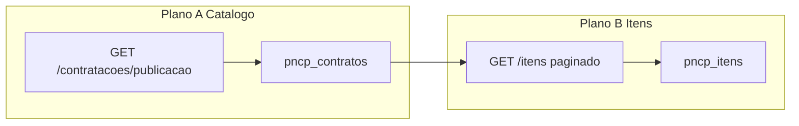

# Planos técnicos — contratos + itens PNCP (set/2026)

**Restrição de produto:** só **1 ano** de itens (cravado). Sem backfill N-1/N-2.

**Números âncora (medidos):**

| Métrica | Valor |
|---------|------:|
| Itens no DB | ~1,52M |
| Contratos no DB | ~461k |
| Média aparente itens/contrato | **3,34** (enviesada) |
| Contratos API 1 ano × mods 6–10 | **~1,34M** |
| Cobertura contratos | **~35%** |
| Contratos com **exactamente 10** itens | **80.015** |
| Contratos com 11 itens | **9** |
| Max itens/contrato no DB | **20** (0 com 21+) |



---

# Plano A — Ingestão de contratações (catálogo)

## Problema

Descoberta via `/contratacoes/publicacao` é **enviesada no tempo**:

- Uma janela rolling 365d (`ingest_dates.resolve_backfill_window`)
- Watermark volta à **página 1** quando `data_inicial/final` mudam 1 dia (`_resolve_backfill_start_page` em `local_index.py`)
- Gap-fill por `updated_at DESC` reforça contratos já tocados
- Evidência: SP mai **24.671** contratos vs out **138**; histograma nacional denso só no arranque

A materialização de itens **acompanha** o catálogo onde há contrato. O buraco de volume é **falta de contratos**.

## Objectivo

Esgotar o ano actual (modalidades default 6–10) → ~**1,34M** contratos no DB → base para ~**4,4M+** itens (antes de corrigir truncagem).

## Desenho técnico

### A1. Partições de ~30 dias

**Ficheiro:** `pncp_researcher_service/app/ingest_dates.py`

- `iter_ingest_windows(lookback_days=365, chunk_days=30)` → lista `(data_inicial, data_final)` AAAAMMDD
- Cada fatia ≤ 365d (limite API)

### A2. Planner com justiça temporal

**Ficheiro:** `pncp_researcher_service/app/ingest_planner.py`

- Por UF×modalidade, escolher **uma fatia** por ciclo (round-robin ou boost por déficit de contagem na fatia)
- Enfileirar só páginas dessa fatia (`PNCP_INGEST_PLANNER_PAGES_PER_SCOPE`)
- Prioridade mais urgente para fatias com cobertura relativa baixa

### A3. Watermark por fatia

**Ficheiro:** `pncp_researcher_service/app/local_index.py` + `pncp_ingest_state`

- Chave: `(uf, modalidade, data_inicial, data_final)` **ou** não resetar `last_page` no roll de 1 dia
- Evitar o loop diário página-1

### A4. Anti-thrash na fila

**Ficheiro:** `pncp_researcher_service/app/ingest_maintenance.py`

- Self-heal: marcar `done` em `catalog_page` pending fora do conjunto activo de fatias

### A5. API backfill com datas absolutas

**Ficheiros:** `schemas.py`, `api_feed.py`, handler de backfill em `local_index.py`

- `LocalBackfillRequest.data_inicial` / `data_final` opcionais (AAAAMMDD)
- Ops: reprocessar um mês específico sem depender do rolling

### A6. Observabilidade

**Ficheiro:** `ingest_coverage.py` (+ rota coverage)

- Histograma mensal de **contratos** e **itens** por `data_publicacao`
- Alerta se top-2 meses > 60%

### A7. Ops imediato (sem código)

1. Purge janelas obsoletas na fila `catalog_page`
2. Um escritor: worker **ou** bash loop — não os dois
3. `PNCP_INGEST_BACKFILL_MODE=0`
4. Backfill `days=60/90` UF a UF enquanto a API aguentar

## Aceite Plano A

- [ ] SP out/2025 contratos sobe de ~138 para ordem comparável a meses fortes (não gap 180×)
- [ ] Histograma nacional deixa de concentrar ~86% no bloco inicial
- [ ] Contratos no DB tendem a ~1,0M–1,34M no ano (5 mods)
- [ ] Só 1 conjunto de datas dominante na fila de catálogo
- [ ] Testes: chunks, planner multi-fatia, watermark sem reset diário, purge

## Fora de A

- Multi-ano (N-1/N-2)
- Expandir modalidades (opcional depois)
- `/atualizacao` como fonte principal de volume

---

# Plano B — Limite artificial de itens por contrato

## Problema

`get_contract_items` em `pncp_client.py` faz **um GET** a:

`{PNCP_PNCP_API}/v1/orgaos/{cnpj}/compras/{ano}/{seq}/itens`

**sem** `pagina` / `tamanhoPagina`. A `pncp-api` pagina e **trunca sem aviso** (default ~10).

Evidência DB:

| Contagem exacta | Contratos |
|-----------------|----------:|
| 10 itens | **80.015** |
| 11 itens | **9** |
| 20 itens | 38 |
| 21+ | **0** |

Contratos reais no PNCP podem ter **centenas** de itens (ex. 600). Max=20 no índice é impossível sem truncagem.

## Objectivo

Materializar **todos** os itens de cada contratação; reprocessar truncados; deixar de usar 3,3 como “média verdadeira”.

## Desenho técnico

### B1. Paginação completa em `get_contract_items`

**Ficheiro:** `pncp_researcher_service/app/pncp_client.py`

```
pagina = 1, tamanhoPagina = 50 (ou máximo permitido pelo endpoint)
enquanto True:
  GET .../itens?pagina=&tamanhoPagina=
  acumular data[]
  se totalPaginas conhecido e pagina >= totalPaginas: break
  se len(chunk) == 0: break
  se len(chunk) < tamanhoPagina e sem totalPaginas: break
  pagina += 1
  safety: pagina > 100 → break + log
```

- Aceitar resposta `dict` (`data`, `totalRegistros`, `totalPaginas`) **e** `list` raw
- Manter retry/throttle via `_get_pncp`
- Se falhar a meio da paginação: não tratar como sucesso completo (caller requeue)

### B2. Testes unitários

**Ficheiro novo:** `pncp_researcher_service/tests/test_pncp_client_items_pagination.py`

- Mock 3 páginas × 10 com `totalPaginas=3` → 30 itens
- Mock list sem meta: 50 + 50 + 3 → para no partial
- 404/204 → `[]`
- Safety cap não entra em loop infinito

### B3. Reprocessamento dos truncados

- Enfileirar `contract_items` para `numero_pncp` com `HAVING COUNT(*) IN (10, 20)`
- Endpoint ou flag `force` que ignore `PNCP_INGEST_ITEMS_REFRESH_DAYS`
- Ritmo controlado (evitar 429): batch diário / limit por tick

### B4. Métricas

- `contratos_com_exact_N_itens` para N ∈ {10, 20, page_size}
- Após deploy: exact-10 deve **cair**
- Histograma itens/contrato: p50 / p90 / p99 / max no coverage

### B5. Validação manual (API up)

- Script: contrato DB count=10 vs API paginada → `API > DB` confirma
- Sample 20 contratos exact-10 reprocessados → maioria com count > 10

## Aceite Plano B

- [ ] `get_contract_items` pagina até esgotar (testes verdes)
- [ ] Contagem exact-10 em queda sustentada
- [ ] Existem contratos com **> 20** itens no DB
- [ ] Max no DB sobe (centenas possível)
- [ ] Média itens/contrato sobe de forma mensurável

## Riscos Plano B

| Risco | Mitigação |
|-------|-----------|
| Mais HTTP → 429 | `tamanhoPagina=50`, throttle existente, requeue gradual |
| API 503 a meio | Não marcar done; retry; idempotência no upsert |
| Contratos genuinamente com 10 itens | Continuam com 10; exact-10 não vai a zero |

---

# Ordem de execução

| Ordem | Plano | Porquê |
|------:|-------|--------|
| **1** | **B — itens** | Diff pequeno; desbloqueia ~80k contratos já no DB |
| **2** | **A — catálogo** | Maior ganho absoluto (~+2,5–3M itens no ano) |
| **3** | Opcional: mods 1–5, 11–13 no mesmo ano | +0,3–1M estimado |

**Ganho combinado (1 ano, 5 mods):** catálogo completo + itens sem truncar → teto **acima** dos 4,4M estimados com ×3,3.

---

# Ficheiros principais

| Plano | Paths |
|-------|--------|
| A | `ingest_dates.py`, `ingest_planner.py`, `local_index.py`, `ingest_maintenance.py`, `schemas.py`, `api_feed.py`, `ingest_coverage.py`, `docker-compose.pncp.yml` |
| B | `pncp_client.py` (`get_contract_items`), testes novos, planner/worker ou endpoint requeue, coverage |

---

# Docs relacionados

- [ANALISE-COBERTURA-TEMPORAL-INDICE-PNCP-SET2026.md](./ANALISE-COBERTURA-TEMPORAL-INDICE-PNCP-SET2026.md)
- [planejamento/03-INGESTAO-24-7.md](./planejamento/03-INGESTAO-24-7.md)
- [planejamento/09-GAPS-E-ROADMAP.md](./planejamento/09-GAPS-E-ROADMAP.md)
- [planejamento/10-SLA-ALIMENTACAO.md](./planejamento/10-SLA-ALIMENTACAO.md)
